COVER_TITLE: Vernex Clinic OS
COVER_SUB: Manual Testing Walkthrough
COVER_SUB: A step-by-step guide to checking every page and every workflow, written for someone who has never seen the app before.
COVER_SUB: For each step you will see what to do, and what the screen should look like when it works.

---

# Contents

| Part | What you will check |
|---|---|
| How to use this guide | Setup, test people, how to report problems |
| 1. The patient's side | Home page, choosing a clinic, booking, My appointments |
| 2. Signing in and out | Sign-in, access denied, staying signed in |
| 3. The platform admin | Creating brands, clinics and logins; sharing people; platform pages |
| 4. Owner and admin | Dashboard, staff, clinic switcher, settings |
| 5. Reception | Check-in, appointments, queue, new patients |
| 6. The doctor | Queue, schedule, consultation, prescription |
| 7. The pharmacy | Stock, dispensing, counter sales, alerts |
| 8. Billing and money | Payments, invoices, receipts, refunds, reports |
| 9. WhatsApp | The simulated WhatsApp pages |
| 10. One whole day | Everything together, start to finish |
| 11. Privacy checks | What each person must not be able to do |
| 12. Phone-sized screens | A full pass on a phone layout |
| 13. A brand-new clinic | Setting up a customer from nothing |
| Appendices | What is not expected to work yet, troubleshooting, checklist, problem log |

Every Part has a bookmark in the PDF viewer's side panel, so you can jump straight to it.

# How to use this guide

## What this guide is for
Vernex Clinic OS is a website that runs a clinic: patients book appointments, the front desk checks them in, the doctor sees them, the pharmacy hands out medicines, and the bill is collected. Different people (called **roles**) sign in and each sees different pages.

This guide walks you through **every page and every workflow**, in the order a real day happens. You do not need any technical knowledge. If you can use a website and follow instructions, you can do this.

Plan on **4 to 5 hours** for everything. You can stop after any Part and continue later. Parts 1 to 2 take about 30 minutes and are a good first session.

## How to read each step
Every step uses coloured boxes, so you can scan quickly:

DO: A thing you do: click, type, or open a page.
EXPECT: What you should see afterwards. Compare it with the screenshot if there is one.
NOTE: A tip, a warning, or something that looks odd but is normal.
TRY: Something our own testing has **not** confirmed yet. You are the first person to check it. Please write down exactly what happens, even if it works.
RESULT:

At the end of each page, tick **Works as described** if everything matched, or **Problem** and write a short note. Problems are normal. Finding them is the point.

## What you need
- A computer with the **Google Chrome** browser.
- The website address. If the developer started the app on their own computer, the address is usually `http://localhost:5173`. Otherwise use the address you were given.
- The **test password**. The developer keeps it in the file `scrips\.secret.env` on the line that starts with `TEST_PASSWORD=`. Ask the product owner for it. All test accounts below use the same password. Do not share it outside the team.
- A phone (optional but recommended) for the phone-size checks.
- A notebook or spreadsheet for your findings (see "Reporting a problem" below).

## Starting the app (only if you are running it yourself)
Open a terminal in the project folder and run:

```
cd frontend
npm run dev
```

Leave that window open. Then open the address it prints (usually `http://localhost:5173`) in Chrome.

## Being two people at once
Many steps need two roles (for example a patient booking while reception watches). Use:
- one normal Chrome window for the first person, and
- one **Incognito window** (press `Ctrl + Shift + N`) for the second person.

Each window keeps its own sign-in. For a third person, use another browser such as Edge or Firefox.

## The test people
Everyone uses the same test password. The first clinic, **TEST Metro Health - Jayanagar**, already has staff and a doctor with a schedule. Use it for Parts 1 to 11.

| Role | Email to sign in with | Who they are |
|---|---|---|
| Platform admin | `super_admin@vernex.test` | Runs the whole platform. Creates clinics. |
| Owner | `owner.jayanagar@testmetro.test` | Owns the Jayanagar clinic. Views, cannot add staff. |
| Admin (shared) | `admin@testmetro.test` | Manages three clinics: Indiranagar, Whitefield, Jayanagar. |
| Receptionist | `reception@testjay.test` | Front desk of Jayanagar (Kavya). |
| Doctor | `doctor@testjay.test` | Dr Meera Rao, Jayanagar. |
| Pharmacist | `pharmacist@testjay.test` | Pharmacy of Jayanagar (Ravi). |
| Owner of another clinic | `owner.whitefield@testmetro.test` | Same brand, different clinic. Used for privacy tests. |
| Owner of an unrelated brand | `owner@testsolo.test` | A completely separate business. Used for privacy tests. |

NOTE: Dr Meera Rao works **Monday to Saturday, 9:00 AM to 5:00 PM, with a lunch break 1:00 to 2:00 PM**, in 15-minute slots. She also has a late test session on **Sunday, 10:00 PM to 11:45 PM**. Slots that are already in the past today are never offered, so if the working hours for today are over, choose tomorrow when a step says "pick a date".

## Testing on a phone-sized screen
Most patients will use a phone. To check the phone layout on your computer: press `F12` in Chrome, then `Ctrl + Shift + M` to switch on the device toolbar, and choose **iPhone SE** or type width **375**. Reload the page. On a phone layout, **nothing should be cut off, and the page must never scroll sideways**.

## Reporting a problem
For every problem write down these four things (a spreadsheet with four columns works well):
1. **Where**: the page name or web address.
2. **What you did**: the exact clicks and what you typed.
3. **What you expected**: copy it from the green EXPECT box.
4. **What happened instead**: include a screenshot (press `Windows + Shift + S`).

Also note the **role** you were signed in as and the **screen size** (computer or phone).

## Words you will see
| Word | Meaning |
|---|---|
| Brand | A business that owns one or more clinics, for example a hospital chain. |
| Clinic | One location. Its data is completely separate from every other clinic. |
| Branch | A sub-location of a clinic. Every new clinic gets a "Main branch". |
| Token | A short code such as A001 given to a patient to show at reception. Numbers restart every day. |
| Slot | A bookable time with a doctor, for example 10:15 AM. |
| Booked / Checked in / With doctor / Completed | The honest stages of a visit. "Booked" only means the slot is reserved, not that anyone confirmed it. |
| Invoice / bill | A charge for a visit or for medicines. |
| Prescription | The doctor's list of medicines. It can be sent straight to the pharmacy. |

---

# Part 1: The patient's side (no sign-in needed)

Patients never sign in. They book from a website link, and look up their appointments with a phone number. Do this Part in a normal window while **not** signed in to anything.

## 1.1 The home page
DO: Open the website address.
EXPECT: A clean page titled **Vernex Clinic OS** with the sentence "Simple, honest healthcare booking. Choose your clinic and reserve an appointment in seconds." Two buttons: **Book an appointment** and **My appointments**. Three small cards: **Instant Reservation**, **Easy Lookup**, **Zero Wait Tokens**. At the top right a quiet **Staff login** link, and at the bottom **Find appointments** and **Staff portal**.

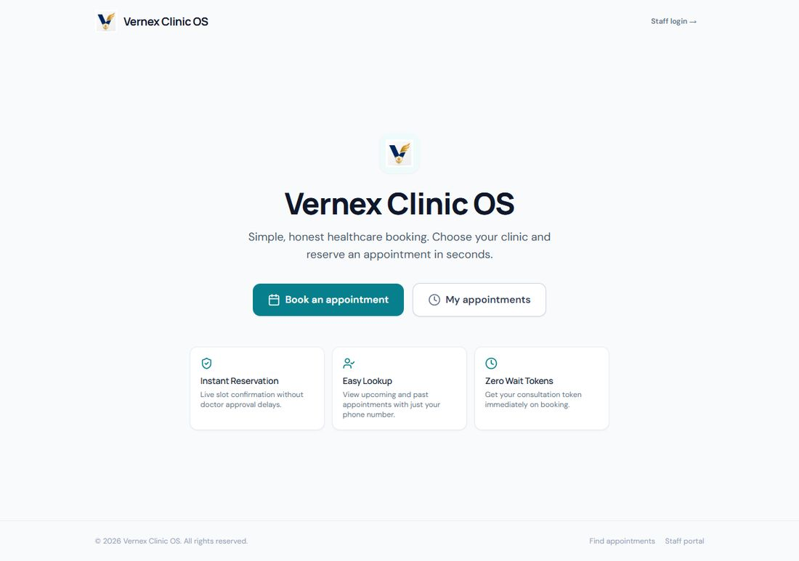

DO: Click each of the four links or buttons, and use the browser's Back button after each.
EXPECT: Book an appointment opens the clinic list. My appointments and Find appointments open the lookup page. Staff login and Staff portal open the sign-in page.
RESULT:

## 1.2 Choosing a clinic
DO: Click **Book an appointment**.
EXPECT: A page called **Choose a clinic** showing one card per clinic, each with its name, what it offers, the address and a phone number. You should see Sunrise Family Clinic, Vernex Multispeciality Clinic and several clinics whose names start with TEST.

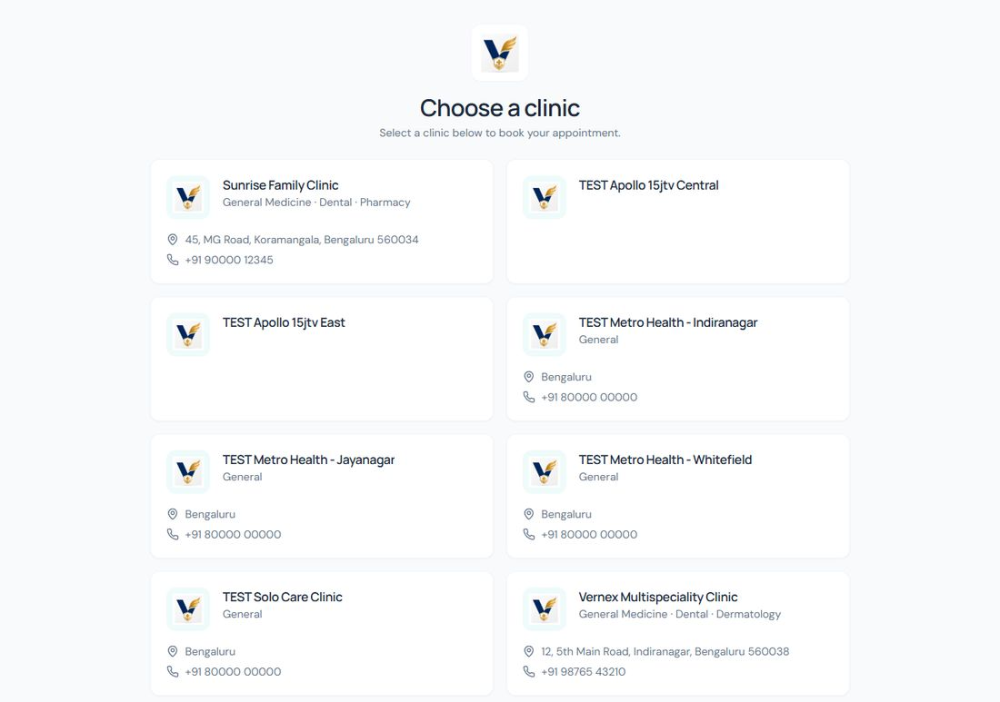

DO: Click **TEST Metro Health - Jayanagar**.
EXPECT: That clinic's own page opens (next section).
RESULT:

## 1.3 A clinic's page
EXPECT: A dark header with the clinic name, the area, a phone number, and three buttons: **Book Appointment**, **Call clinic**, **WhatsApp**. Under it a **Choose Doctor** list with **Dr Meera Rao** (specialisation, qualification and the fee **₹500**) and a second doctor. A **Select Service** box that says "No services listed" is normal until the clinic adds services. Further down: a WhatsApp demo, a QR code, and a **Copy link** button.

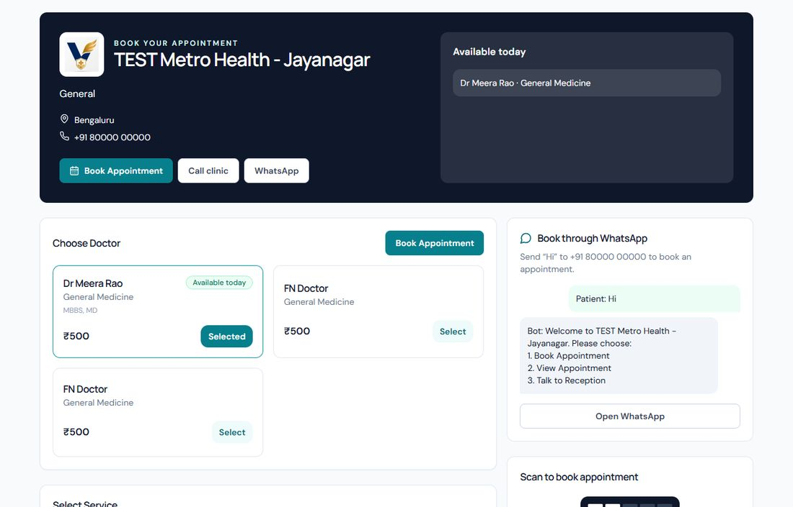

NOTE: Doctors must **not** look greyed out just because they are off today. A patient on a Sunday must still be able to choose a doctor and book for Monday.

DO: Click **Copy link**, then paste it into a new browser tab.
EXPECT: The same clinic page opens, which proves the link can be shared.
RESULT:

## 1.4 Booking an appointment: the five steps
A bar at the top shows five steps: **1. Choose Doctor**, **2. Select Service**, **3. Pick Date & Time**, **4. Enter Patient Details**, **5. Confirm Appointment**. A **Booking Summary** box on the right updates as you go.

### Step 1: Choose Doctor
DO: On the clinic page click **Book Appointment**. Make sure **Dr Meera Rao** shows **Selected**, then click **Continue**.

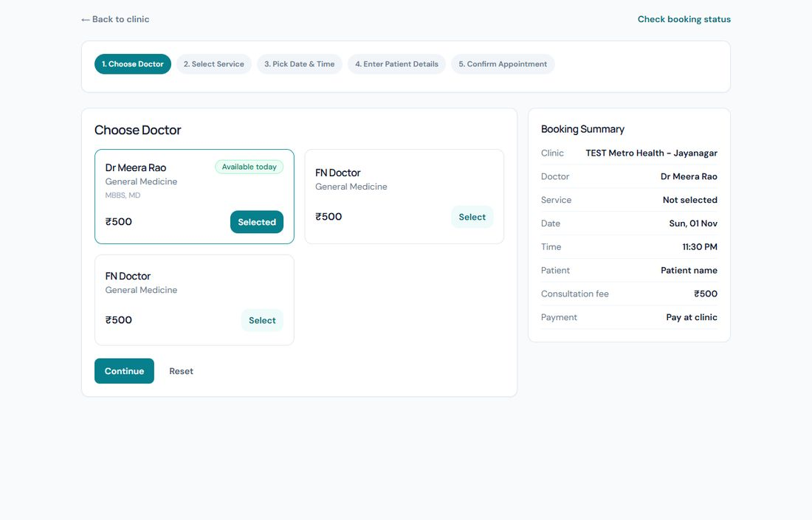

EXPECT: The summary on the right shows the clinic, the doctor, the fee ₹500 and "Pay at clinic".

### Step 2: Select Service
EXPECT: "No services listed. You can continue; the clinic will confirm the service at the front desk."
DO: Click **Continue**.

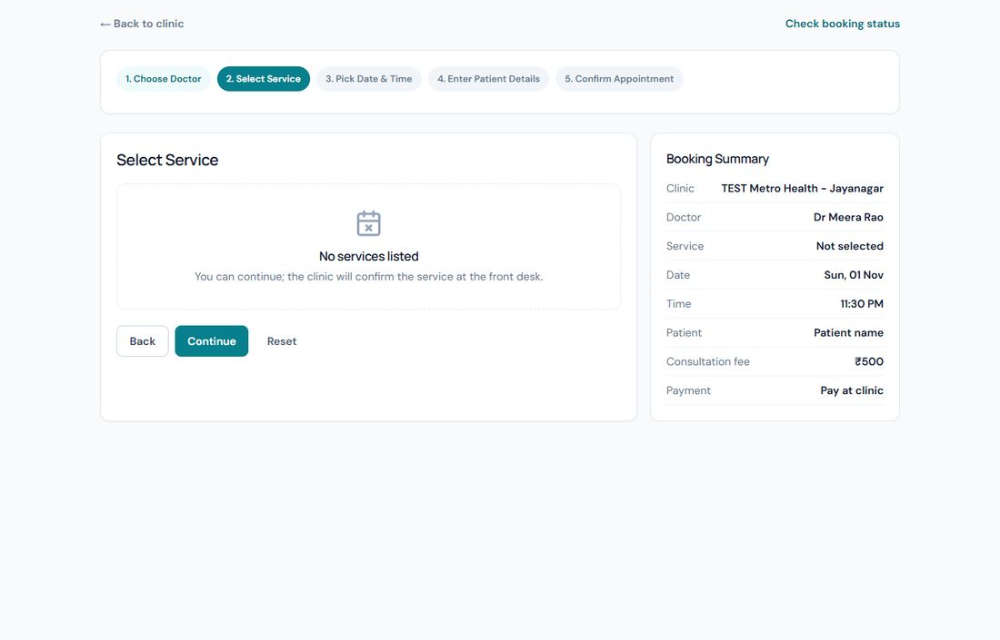

### Step 3: Pick Date & Time
EXPECT: A row of date buttons for the next two weeks, then the times for the chosen date. Available times are filled teal; taken times are grey with the word **BOOKED**. Times that have already passed today do not appear. Only the parts of the day that have times (Morning, Afternoon, Evening) are shown. The lunch break 1:00 to 2:00 PM must have **no** slots, and Sunday daytime must have none.

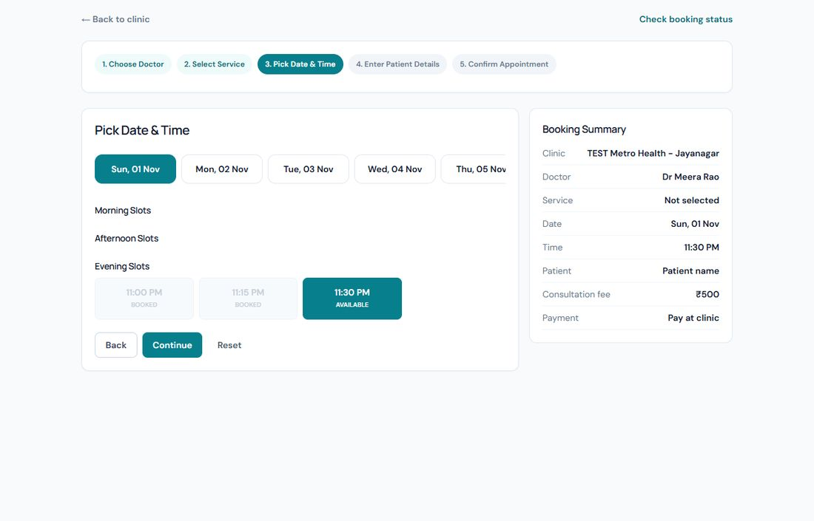

DO: Click a few different dates, then choose one time and click **Continue**.
EXPECT: The summary shows the date and the time in **12-hour format** such as 10:15 AM.

### Step 4: Enter Patient Details
DO: First click **Continue to Confirm** without typing anything.
EXPECT: Red messages appear: **Name required**, **Phone required**, **Reason required**. You cannot move on.

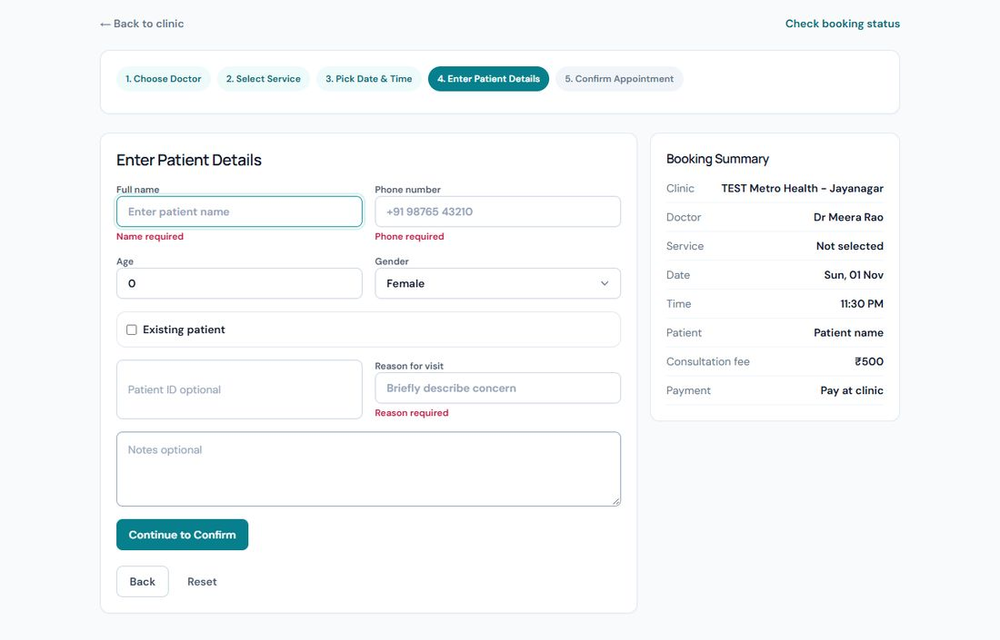

DO: Now fill in: Full name `Asha Verma`, Phone number a 10-digit number starting with 9 (for example `9812345678`), Age `29`, Gender Female, Reason for visit `Fever for two days`. Click **Continue to Confirm**.

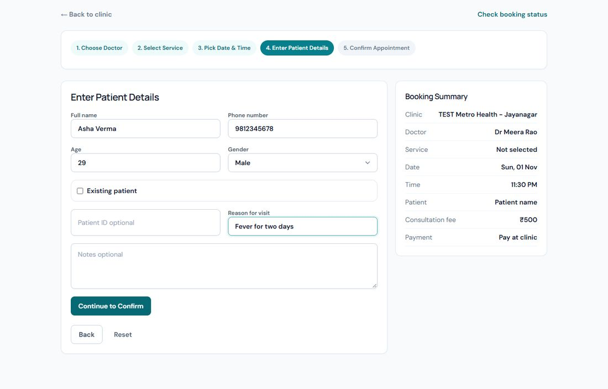

### Step 5: Confirm Appointment
EXPECT: Two payment choices: **Pay at clinic** (chosen) and **Pay online placeholder** with the words "Online payment is not available yet". That second choice is expected for now. The summary on the right shows your name.
DO: Click **Back**, then **Continue to Confirm** again to check your details were kept. Then click **Confirm Appointment**.

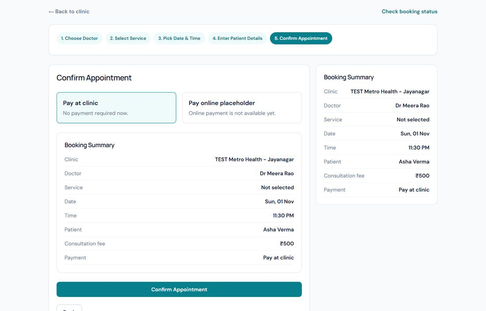
RESULT:

## 1.5 The booking success page
EXPECT: A page headed **Appointment Booked** with the line "Your slot is reserved. Please arrive 10 minutes early and show your token at reception." A **Booked** badge, a **Token** such as A005, a short **Booking ref**, the doctor, the date and time (12-hour), your name, and the clinic name with its address. Buttons: **Add to Calendar**, **Print**, **WhatsApp clinic**, **Call clinic**, **View all my appointments**, **Back to clinic page**.

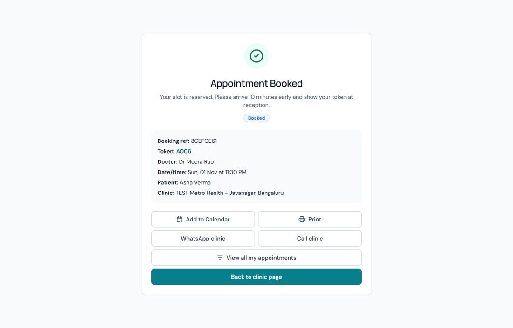

NOTE: The wording must say **Booked** or **slot is reserved**. It must never say a doctor has "confirmed" the booking.

DO: Click **Add to Calendar** and **Print**.
EXPECT: Add to Calendar opens a calendar page with the doctor and token filled in. Print opens the print preview.
RESULT:

## 1.6 Two people booking the same slot
This checks that two patients can never get the same slot.
DO: Open the booking flow in **two windows** and choose the **same doctor, date and time** in both, so both stop at the confirm step. Click **Confirm Appointment** in the first window, then in the second.
EXPECT: The first booking succeeds. The second shows the message **"This slot was just taken, please pick another"** and does not create a booking.
RESULT:

## 1.7 My appointments (finding a booking with a phone number)
DO: From the home page click **My appointments**.

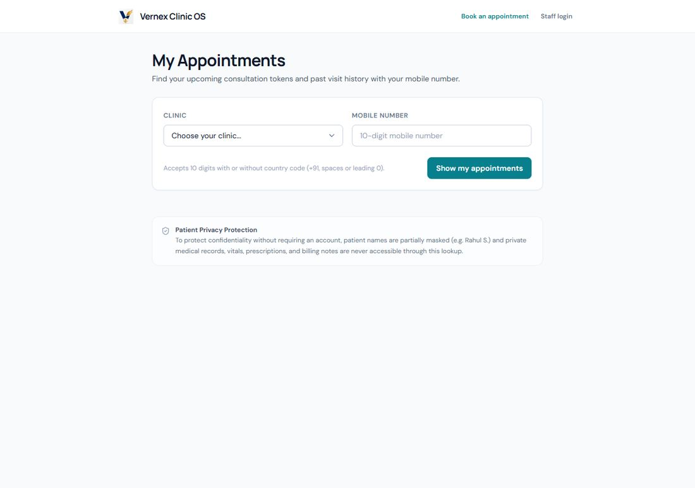

EXPECT: A form with a **Clinic** dropdown and a **Mobile number** box, the hint "Accepts 10 digits with or without country code (+91, spaces or leading 0)" and a privacy note.
DO: Choose **TEST Metro Health - Jayanagar**, enter the phone number you booked with, and click **Show my appointments**.
EXPECT: Cards under **Upcoming appointments**, soonest first, each with the token, a **Booked** badge, "Booked - your slot is reserved", the doctor, the clinic, the date and 12-hour time, and a short ref. Your name is **partly hidden**, for example **Asha V.**, and no medical or billing details appear anywhere.

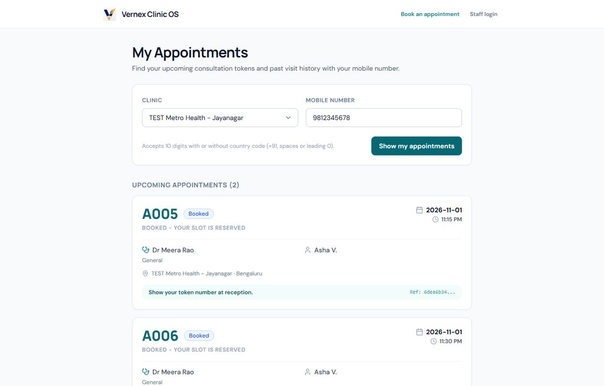

DO: Search again, typing the same number in different ways: `9812345678`, `+91 98123 45678`, `09812345678`, `98123-45678`.
EXPECT: Every version shows the same appointments.
TRY: Search with a number that has no bookings.
EXPECT: A friendly "no appointments found" message, not an error screen.
TRY: Press **Show my appointments** six or seven times quickly.
EXPECT: After about five tries the message **"Too many tries, please try again in a few minutes"**.
DO: Choose a **different clinic** and search the same number.
EXPECT: No results. Each clinic only shows its own bookings.
RESULT:

## 1.8 The same pages on a phone
DO: Switch to the phone layout (see "Testing on a phone-sized screen") and repeat 1.1 to 1.7 quickly.
EXPECT: Everything fits the screen, buttons are large enough to tap, nothing is cut off, and the page never scrolls sideways. On the clinic page the doctor cards stack in one column.

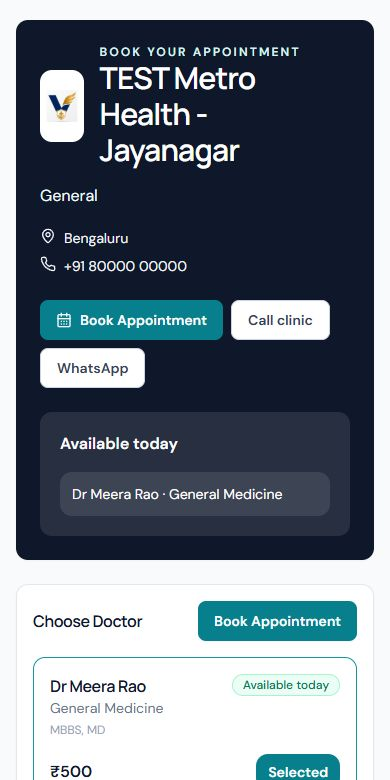
RESULT:

---

# Part 2: Signing in and out

## 2.1 The sign-in page
DO: Open the website address followed by `/login`, or click **Staff login**.
EXPECT: A two-sided page. On the left the words "Care, connected." and a few benefits. On the right **Sign in to your clinic** with two boxes, **Email or staff ID** and **Password**, a **Enter workspace** button, and a small link "Booking a visit? Book an appointment".

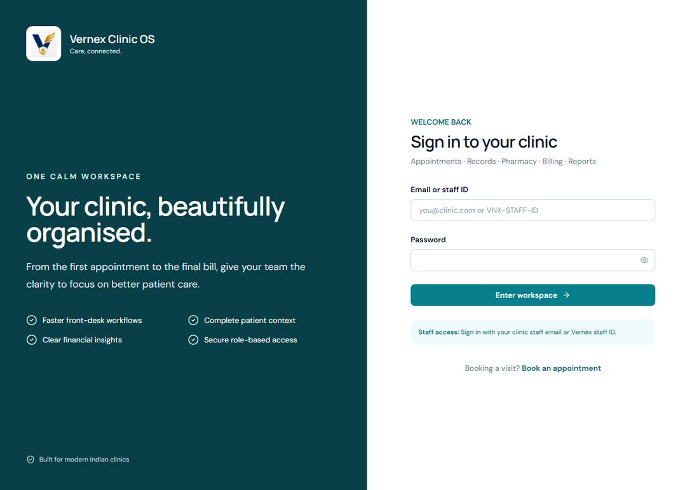
RESULT:

## 2.2 Wrong details
DO: Type a real email and a wrong password, then click **Enter workspace**.
EXPECT: A red message tells you the sign-in failed. You stay on the sign-in page and nothing private is shown.
DO: Leave both boxes empty and click the button.
EXPECT: The browser asks you to fill in the box.
DO: Click the little eye icon in the password box.
EXPECT: The password becomes visible, then hidden again.
RESULT:

## 2.3 Signing in as each person
DO: Sign in as each person in the table at the top of this guide, one at a time, and note where you land.
EXPECT:
- Owner and Admin land on **Clinic overview**.
- Receptionist lands on **Reception dashboard**.
- Doctor lands on the **Doctor queue**.
- Pharmacist lands on the **Pharmacy dashboard**.
- Platform admin lands on **Platform overview**.

Each person also sees a **different menu** on the left. A receptionist must not see the Staff or Settings menu; a doctor sees only Queue, Availability and Follow-ups.
TRY: Sign in using a **Staff ID** instead of an email (the IDs are shown in the Staff list, for example `TESTME-DOC-002`).
EXPECT: It works the same way.
RESULT:

## 2.4 Pages you are not allowed to open
DO: Sign in as the **doctor**. In the address bar change the end of the address to `/owner/dashboard` and press Enter.
EXPECT: A page saying **Access denied: You are signed in, but your account can't open this page.** You are not shown any owner information.

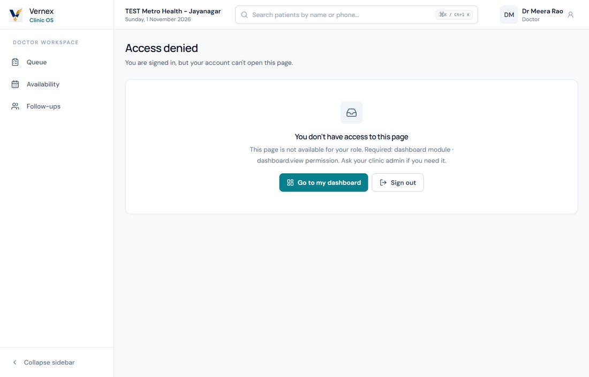

DO: Try the same with `/reception/dashboard`, `/pharmacy/stock` and `/super-admin/dashboard`.
EXPECT: Access denied every time.
RESULT:

## 2.5 Staying signed in, and signing out
DO: Press `F5` to refresh any page.
EXPECT: You stay signed in on the same page.
DO: Click your name at the top right, then **Log out**.
EXPECT: You return to the sign-in page. Pressing the browser's **Back** button must **not** show the private page again.
RESULT:

---

# Part 3: The platform admin (creates clinics)

Sign in as `super_admin@vernex.test`. This person sets up businesses. They do not work inside a clinic.

## 3.1 The overview page
EXPECT: A page called **Platform overview**. Left menu: **All Clinics, Subscriptions, Usage, Monitoring, Support, System Settings**. Five number cards (Total clinics, Active clinics, Trial clinics, Suspended/expired, Staff profiles). Below them a **Clinics** table with columns **Clinic, Brand, Slug, Modules, Status, Action**, a **Create clinic** form, then boxes for Enabled modules, Permission actions, Branch management, **Create a login for a clinic**, **Share a person between clinics**, and a long **Staff users** table at the bottom.

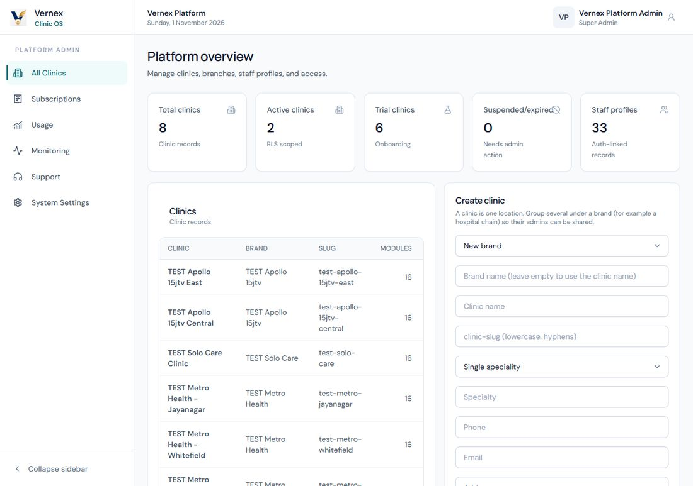

NOTE: This is a busy page. It is meant for the platform team, not for clinics.
RESULT:

## 3.2 Create a new brand with its first clinic
DO: In **Create clinic** leave the brand set to **New brand**. Type Brand name `Walkthrough Health`, Clinic name `Walkthrough Health - Central`, slug `walkthrough-central`. Click **Create clinic**.
EXPECT: A message: "Clinic created with a main branch and all modules enabled. Next: create its owner and admin below." A new row appears in the Clinics table with the brand **Walkthrough Health**, status **trial** and the module count 16.
DO: Open `/book` in another tab.
EXPECT: The new clinic is listed there.
RESULT:

## 3.3 Slugs must be valid and unique
DO: Try to create a clinic with the slug `Bad Slug!`.
EXPECT: The browser refuses and asks for lowercase letters, numbers and single hyphens.
DO: Try to create another clinic with the slug `walkthrough-central`.
EXPECT: A red message saying that a clinic with that slug already exists.
RESULT:

## 3.4 A second clinic in the same brand
DO: In the Brand box choose **Add to brand: Walkthrough Health**. Clinic name `Walkthrough Health - East`, slug `walkthrough-east`. Click **Create clinic**.
EXPECT: Both clinics show the brand **Walkthrough Health** in the table.
RESULT:

## 3.5 Create the owner and the admin
DO: In **Create a login for a clinic** choose the clinic **Walkthrough Health - Central**, role **owner**, name `Central Owner`, email `owner.central@walkthrough.test`, a password of at least 8 characters, then **Create login**.
EXPECT: A message such as "Created owner login for Central Owner (staff ID ...). They can sign in with owner.central@walkthrough.test."
DO: Repeat for **Walkthrough Health - East** with `owner.east@walkthrough.test`.
DO: Now choose **Central**, role **admin**, name `Shared Admin`, email `admin@walkthrough.test`. A box appears: "Also let them work in these clinics of the same brand". Tick **Walkthrough Health - East**. Click **Create login**.
EXPECT: Created admin message. In the Staff users table the admin shows the clinic name followed by **+1 more**.

NOTE: Write down the emails and the password you chose. You will use them in Part 13.
RESULT:

## 3.6 Sharing an existing person
DO: In **Share a person between clinics** pick one of your people and look at the clinic list.
EXPECT: Only clinics of the **same brand** are offered. A person from a different brand never sees your clinics.
TRY: Pick someone, choose a clinic, click **Give access**, then click **Remove** next to it.
EXPECT: Access is added and then removed. You cannot remove a person's last clinic.
RESULT:

## 3.7 Activate and suspend a clinic
DO: In the Clinics table click **Activate** on a trial clinic, then **Suspend**.
EXPECT: The status changes to **active**, then **suspended**.
TRY: With a clinic suspended, open its public booking page and try to sign in as its owner.
EXPECT: Note what happens; a suspended clinic should not be able to take bookings or let staff work.
RESULT:

## 3.8 Subscriptions, Usage, Support, System Settings, Monitoring
DO: Open each page from the left menu.

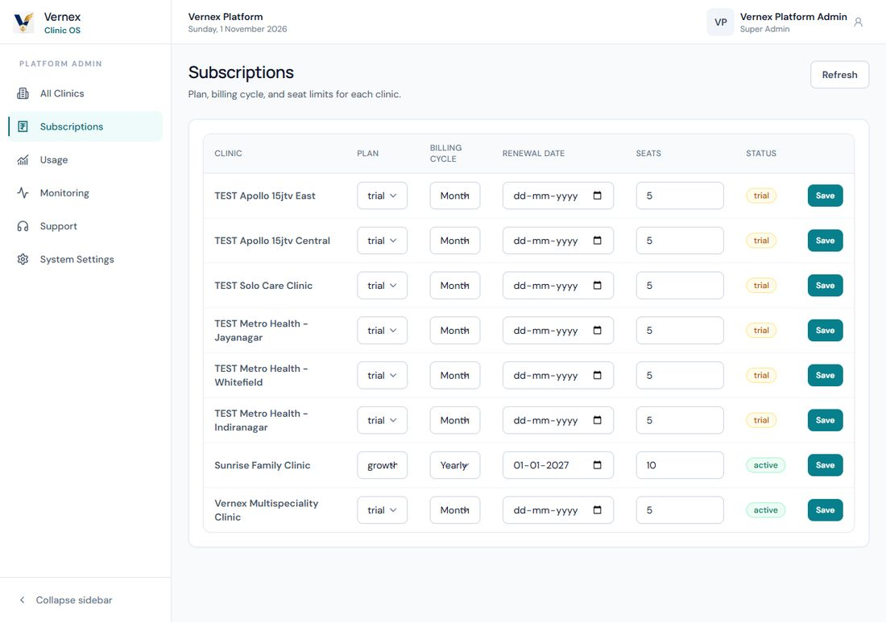

EXPECT:
- **Subscriptions**: one row per clinic with a plan dropdown (trial, starter, growth, enterprise), billing cycle (Monthly or Yearly), renewal date, seats, status, and a **Save** button.
- **Usage**: four totals (Clinics, Staff profiles, Patients, Appointments) and a table with staff, patient and appointment counts per clinic.
- **Support**: tickets from clinics with counts for Open, In progress, Resolved, and buttons **In progress** and **Resolve**.
- **System Settings**: a table of the 17 modules and how many clinics use each.
- **Monitoring**: counts of recent actions, errors and security events, with filters.
TRY: On Subscriptions change a clinic's plan, click **Save**, and refresh.
EXPECT: The change is still there.
TRY: On Support click **Resolve** on a ticket.
EXPECT: Its status becomes Resolved and the counts update.
RESULT:

---

# Part 4: The clinic owner and clinic admin

Sign in as `owner.jayanagar@testmetro.test`. Owners and admins see the same menu: **Dashboard, Appointments, Patients, Pharmacy, Billing, Pending Payments, Reports, Monitoring, Staff, Settings**. The difference: only an **admin** can add staff.

## 4.1 The owner dashboard
EXPECT: A page called **Clinic overview** with the clinic name. Eight cards: Revenue this month, Appointments today, Waiting Patients, New Patients, Repeat Patients, Pharmacy Sales, Pending Payments, Follow-ups Due. Under them: a **Revenue trend** chart, an **Appointment status** doughnut, **Today's appointments**, **Doctor-wise revenue**, **Recent payments** and **Low stock medicines**.

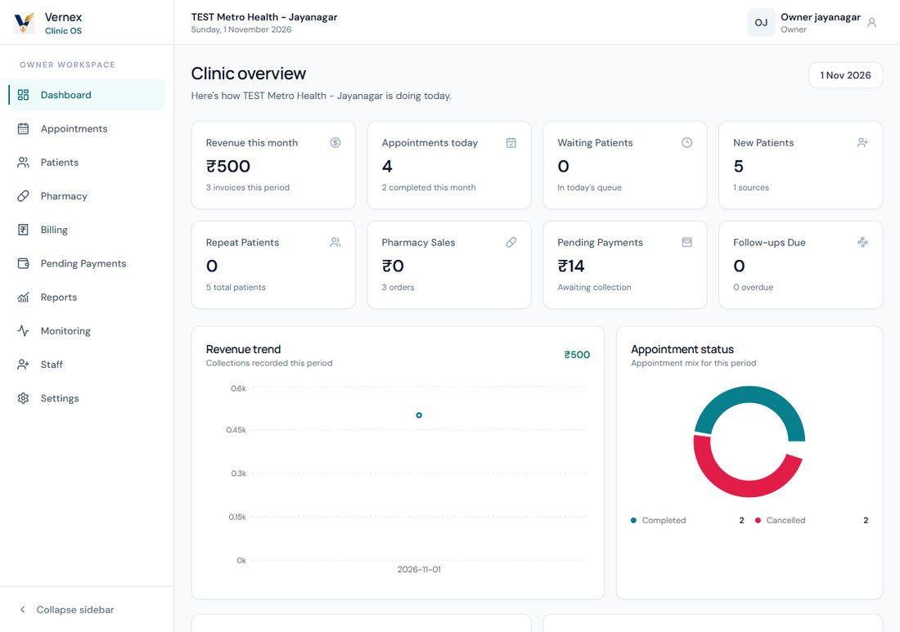

DO: Compare the numbers with the real pages: Pending Payments should equal the total on the Pending Payments page, and Revenue should equal what you collected in Part 8.
EXPECT: The numbers agree. Times are in 12-hour format. Empty sections say what will appear there instead of showing a blank box.
NOTE: With very small amounts the chart labels can look odd. Note it if it looks broken.
RESULT:

## 4.2 Staff
DO: Click **Staff**.
EXPECT: Four summary cards (Total staff, Active, Doctors, Front office), a search box with Role and Status filters, and a **Staff directory** table with **Name, Staff ID, Role, Branch, Contact, Modules, Status**.

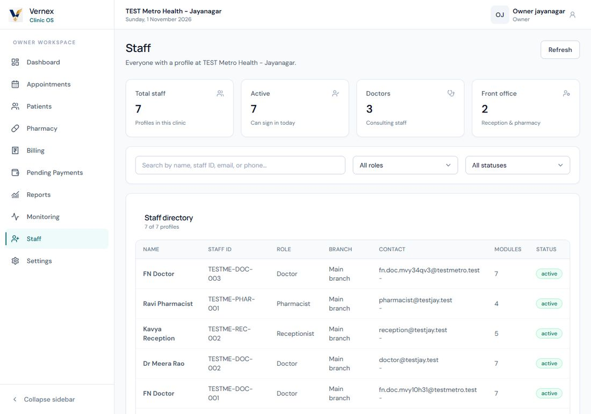

EXPECT (as the owner): There is **no Add staff button**, and a note says onboarding is handled by the clinic admin.
DO: Type part of a name in the search box, then use the Role and Status filters.
EXPECT: The table narrows as you type, and the "x of y profiles" count changes.
RESULT:

## 4.3 Adding staff (admin only)
DO: In a second window sign in as `admin@testmetro.test` and open **Staff**.
EXPECT: An **Add staff** button at the top right.
DO: Click it.

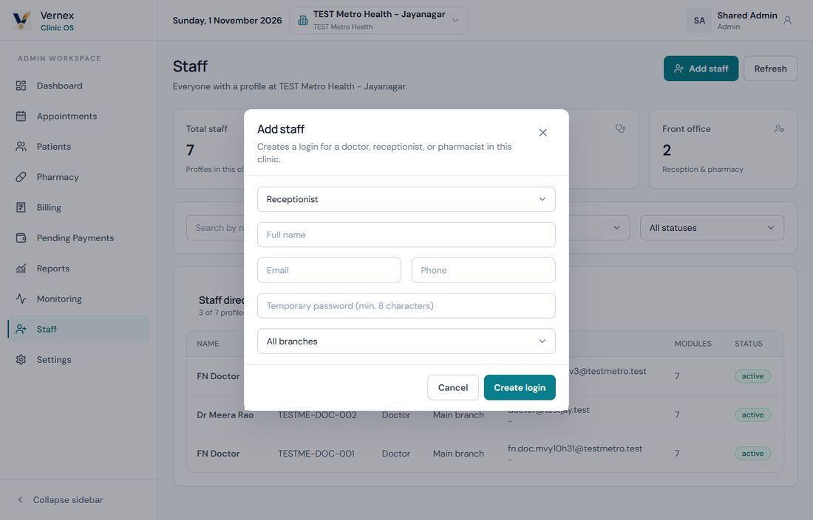

EXPECT: A form for **a doctor, receptionist or pharmacist in this clinic** with Role, Full name, Email, Phone, Temporary password (minimum 8 characters) and Branch. Choosing **Doctor** adds Department, Specialization, Qualification, **Consultation fee** and Slot duration.
DO: Create a doctor: name `Dr Test Two`, a new email, a password, Specialization `General Medicine`, Consultation fee `300`. Click **Create login**.
EXPECT: A success message with the new staff ID, and the person appears in the directory straight away.
DO: Sign in as the new doctor in an Incognito window.
EXPECT: It works and lands on the Doctor queue.
DO: Try the same email again.
EXPECT: An error saying that email is already used.
TRY: Try the **Role** list as admin.
EXPECT: Only Doctor, Receptionist and Pharmacist are offered. An admin cannot create another admin or an owner.
RESULT:

## 4.4 Working in several clinics (the clinic switcher)
DO: Signed in as `admin@testmetro.test`, look at the top bar.
EXPECT: A box with a building icon and the clinic name, with a small arrow.

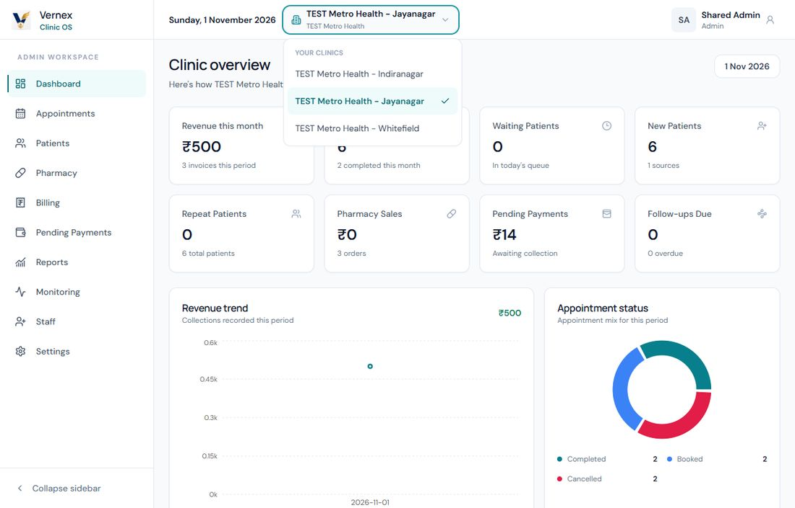

DO: Click it.
EXPECT: A list headed **Your clinics** with three clinics, the current one ticked.
DO: Choose **TEST Metro Health - Whitefield**.
EXPECT: A message "Switched to ...", the page reloads, and the top bar now shows Whitefield. The Staff list and patient lists are now Whitefield's, not Jayanagar's.
DO: Switch back to Jayanagar.
EXPECT: Jayanagar's data is back.
DO: Sign in as `owner.jayanagar@testmetro.test`.
EXPECT: **No** switcher is shown, because this owner works in only one clinic.
RESULT:

## 4.5 Settings
DO: As the owner, click **Settings**.

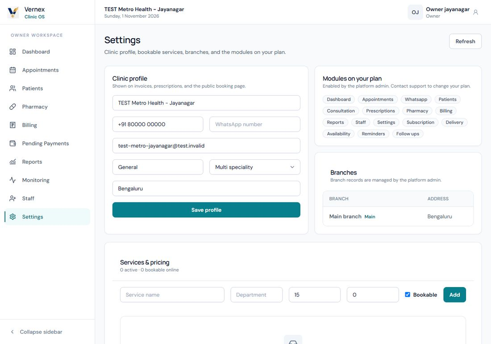

EXPECT: Four areas: **Clinic profile** (name, contact details, Single or Multi speciality, **Save profile**), **Modules on your plan** (a read-only list), **Branches** (read-only, "managed by the platform admin"), and **Services & pricing** with an **Add** button and the note "No services yet".
TRY: Add a service: name `General Consultation`, price `500`, tick **Bookable**, click **Add**.
EXPECT: It appears in the list. Then open the clinic's public page: the service should now appear under **Select Service**.
TRY: Change the clinic phone number and click **Save profile**.
EXPECT: A success message, and the new number shows on the public clinic page.
RESULT:

## 4.6 Other pages the owner can open
DO: Open **Appointments**, **Patients**, **Pharmacy**, **Billing**, **Pending Payments**, **Reports** and **Monitoring** from the menu.
EXPECT: Each opens without errors. They are the same pages described in Parts 5, 7 and 8.
RESULT:

---

# Part 5: Reception (the front desk)

Sign in as `reception@testjay.test`. Menu: **Reception Dashboard, Appointments, Queue, New Patient, Billing, Pending Payments**. This is the busiest role, so look closely.

## 5.1 The reception dashboard
DO: Open the dashboard.

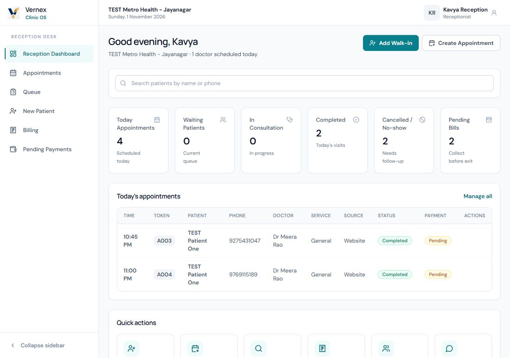

EXPECT: A greeting using the person's first name ("Good evening, Kavya"), the clinic name and "1 doctor scheduled today". Buttons **Add Walk-in** and **Create Appointment**. A **patient search** box that really works. Six cards (Today Appointments, Waiting Patients, In Consultation, Completed, Cancelled / No-show, Pending Bills). **Today's appointments** comes first, with time in 12-hour format, token, patient, phone, doctor, status badge and buttons. A **Live Queue Preview**, **Quick actions**, and **Pending Billing**.
DO: Type two letters of a patient's name into the search box.
EXPECT: Matching patients appear with phone, age and gender. Typing something that does not exist shows "No patient found".
RESULT:

## 5.2 Checking a patient in
First make a booking as in 1.4 for **today** (if there is a slot left today).
DO: On the dashboard find the new appointment. Its status is **Booked** and its button says **Check in**. Click it.
EXPECT: A message "Patient checked in." The status becomes **Checked in** and the Waiting Patients card goes up by one.
DO: Look at the row again.
EXPECT: The button now says **Send to queue**. There is no way to push the patient "backwards".
DO: Look at a row whose status is **Completed** or **Cancelled**.
EXPECT: It has **no action buttons**.
NOTE: Previously these buttons appeared on every row. A receptionist could accidentally reset a patient who was already with the doctor.
RESULT:

## 5.3 The appointments list
DO: Click **Appointments**.

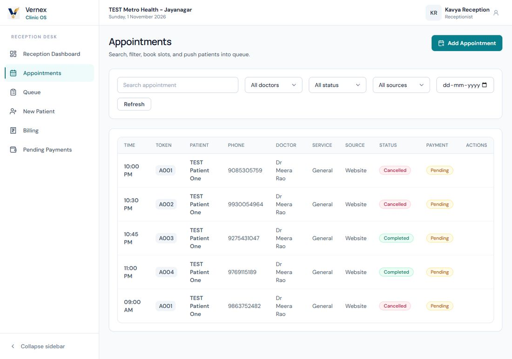

EXPECT: A search box and filters (doctor, status, source, date), then a table with **Time, Token, Patient, Phone, Doctor, Service, Source, Status, Payment, Actions**. Statuses are coloured badges.
DO: Use each filter.
EXPECT: The table narrows correctly; Refresh reloads it.
RESULT:

## 5.4 Booking over the phone (Add Appointment)
DO: Click **Add Appointment**.

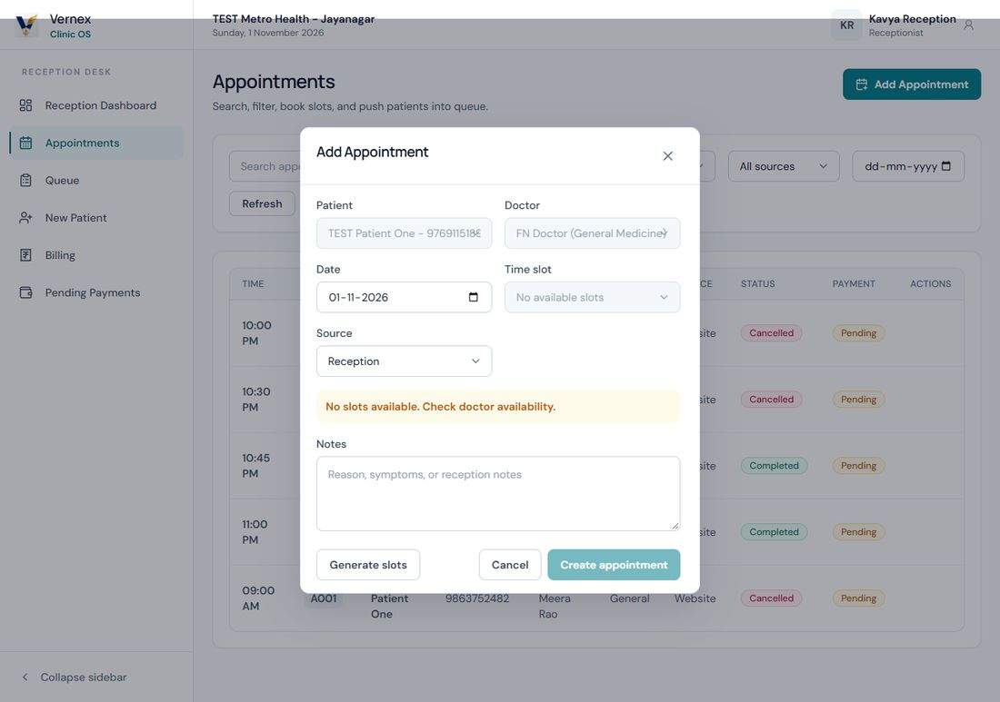

EXPECT: A form with **Patient**, **Doctor**, **Date**, **Time slot**, **Source** (Reception, Walk-in, Phone, WhatsApp, Website), **Notes**, and buttons **Generate slots**, **Cancel**, **Create appointment**.
NOTE: For a moment the form may say "No active doctors" while it loads. It should fill in within a second or two.
DO: Choose a patient, choose **Dr Meera Rao**, pick tomorrow, pick a time slot, choose Source **Phone**, click **Create appointment**.
EXPECT: A success message, and the appointment appears in the table with a new token, status Booked and source **Phone**.
DO: Look at that same time on the public booking page.
EXPECT: That time now shows as **BOOKED**.
RESULT:

## 5.5 Reschedule and cancel
TRY: On a **Booked** appointment click **Reschedule**, choose a new date and time, and confirm.
EXPECT: The row shows the new time. The old time becomes available again on the public page.
TRY: Click **Cancel** on a Booked appointment and confirm.
EXPECT: Status **Cancelled**; the slot is free again. Look the patient up in **My appointments**: it must show as cancelled.
TRY: After cancelling, book the freed slot as a patient.
EXPECT: It works and the next token is issued.
RESULT:

## 5.6 The live queue
DO: Click **Queue**.

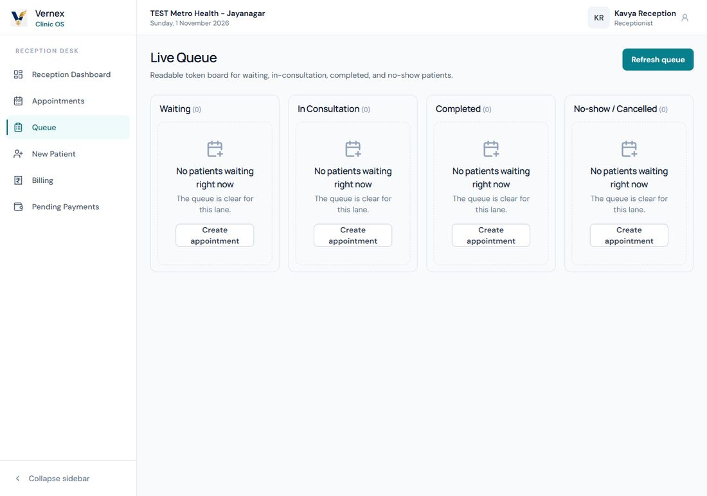

EXPECT: **Live Queue**, a board with lanes **Waiting, In Consultation, Completed** (and a way to see no-shows). Empty lanes say "No patients waiting right now" with a **Create appointment** button. A checked-in patient appears in **Waiting** with a large token.
DO: Check in a patient and press **Refresh queue**.
EXPECT: The patient appears in the Waiting lane. When the doctor starts the visit (Part 6) the patient moves to **In Consultation**.
RESULT:

## 5.7 Registering a new patient or walk-in
DO: Click **New Patient** (or **Add Walk-in** on the dashboard).

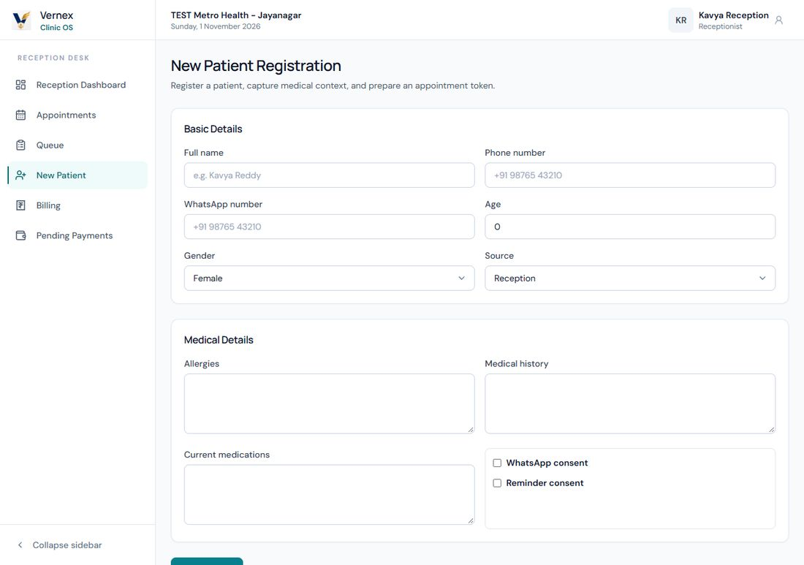

EXPECT: **New Patient Registration** with **Basic Details** (Full name, Phone number, WhatsApp number, Age, Gender, Source), **Medical Details** (Allergies, Medical history, Current medications), two consent ticks (**WhatsApp consent**, **Reminder consent**), buttons **Save Patient** and **Reset**, and below, a searchable list of patients with **Edit** buttons.
TRY: Fill in a new patient and click **Save Patient**.
EXPECT: A success message and the patient appears in the list below.
TRY: Register the **same phone number** again.
EXPECT: A warning about a duplicate, not a second copy.
TRY: Click **Edit** on a patient, change the age, and save.
EXPECT: The change is saved.
RESULT:

## 5.8 Billing shortcut
DO: Click **Billing**.

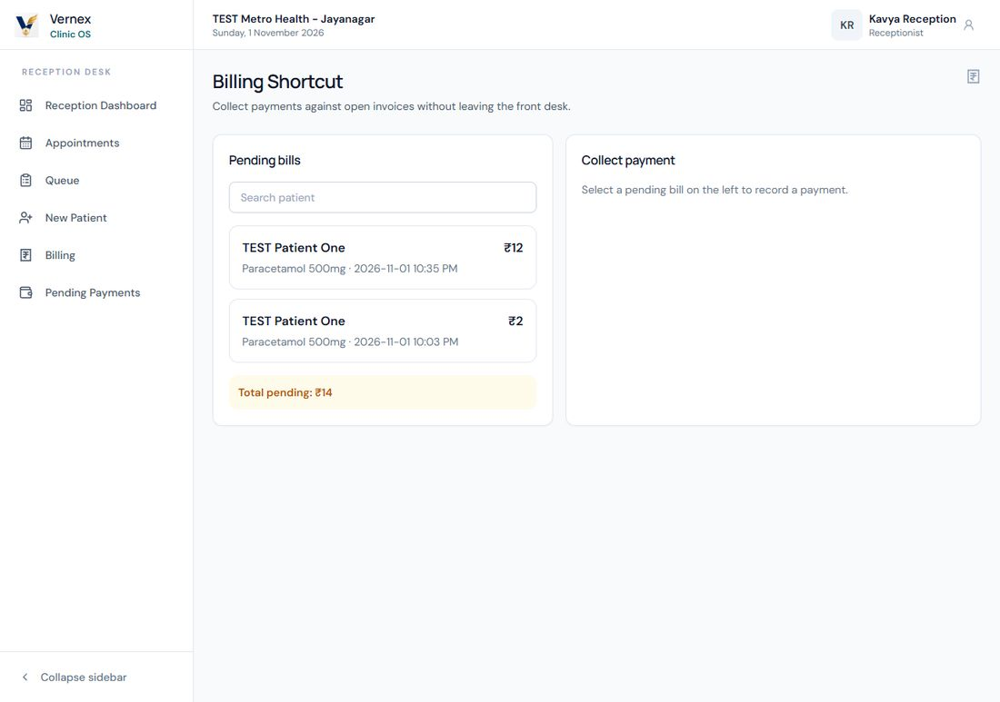

EXPECT: **Billing Shortcut** with a list of **Pending bills** on the left (patient, amount, what it was for, time in IST) and a **Collect payment** area on the right. Clicking a bill fills in the form on the right. The total pending is shown.
NOTE: You will use this in Part 8.
RESULT:

---

# Part 6: The doctor

Sign in as `doctor@testjay.test` (Dr Meera Rao). Menu: **Queue, Availability, Follow-ups**.

## 6.1 The doctor queue
DO: Open the queue.

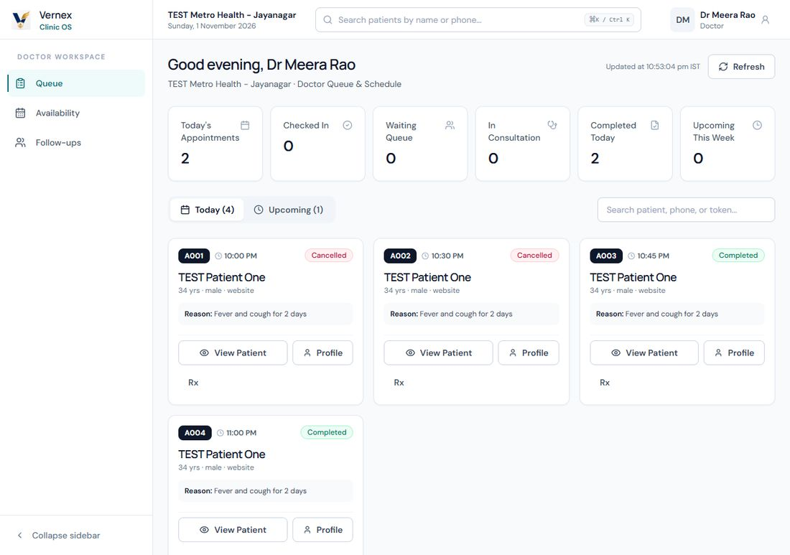

EXPECT: A greeting with the doctor's name ("Good evening, Dr Meera Rao" with a single "Dr"), the clinic name, "Updated at ... IST", a **Refresh** button. Six cards: Today's Appointments, Checked In, Waiting Queue, In Consultation, Completed Today, Upcoming This Week. Tabs **Today (n)** and **Upcoming (n)**. Each appointment is a card with token, time, patient, age, gender, source, status badge and the reason for the visit.
DO: Find a patient who is only **Booked** (reception has not checked them in).
EXPECT: The card says "Awaiting check-in at reception" and offers only **View Patient**, **Profile** and **Rx**. There is **no Start Consultation** button yet.
DO: Check that patient in as reception, then press **Refresh**.
EXPECT: The card now says **Checked in** and shows **Start Consultation**.
DO: Click **Upcoming**.
EXPECT: Tomorrow's bookings appear here, with the date.
NOTE: The page refreshes itself about every 30 seconds.
RESULT:

## 6.2 Availability (the doctor's schedule)
DO: Click **Availability**.

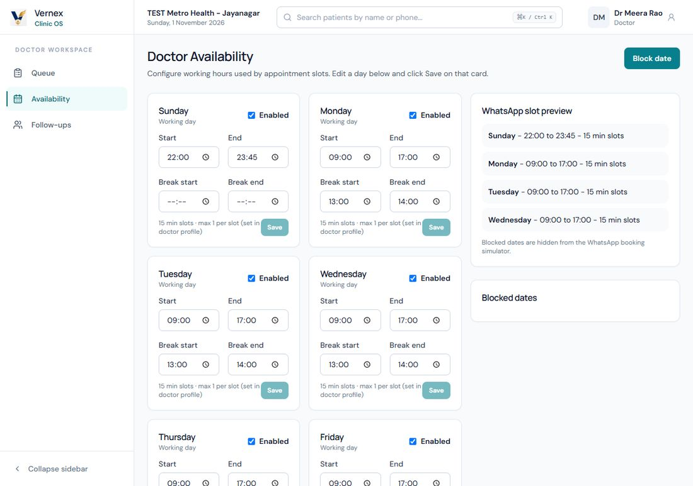

EXPECT: Seven cards, one per day. Each has an **Enabled** tick, **Start** and **End** times, **Break start** and **Break end**, the line "15 min slots", and its own **Save** button. A **Block date** button at the top right and a "Blocked dates" box.
DO: On Monday change End to 12:00 and click **Save** on that card.
EXPECT: A message "Monday availability saved." If a patient is already booked after 12:00, a plain warning explains that booking is outside the new hours; it is **not** deleted.
DO: Open the clinic's public booking page and look at next Monday.
EXPECT: Slots now end at 11:45 AM.
DO: Put Monday back to 5:00 PM and save.
DO: Untick **Enabled** on Saturday and Save.
EXPECT: Saturday no longer offers any dates to patients.
DO: Click **Block date**.

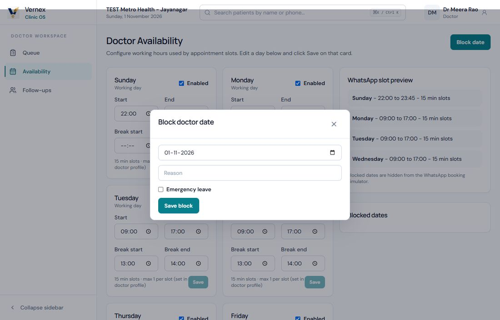

EXPECT: A small window "Block doctor date" with a date box, a reason (such as Emergency leave) and **Save block**.
DO: Block a date next week.
EXPECT: That date disappears from the patient date picker, and appears under Blocked dates.
RESULT:

## 6.3 Seeing a patient: the consultation
DO: In the queue, click **Start Consultation** on a checked-in patient.

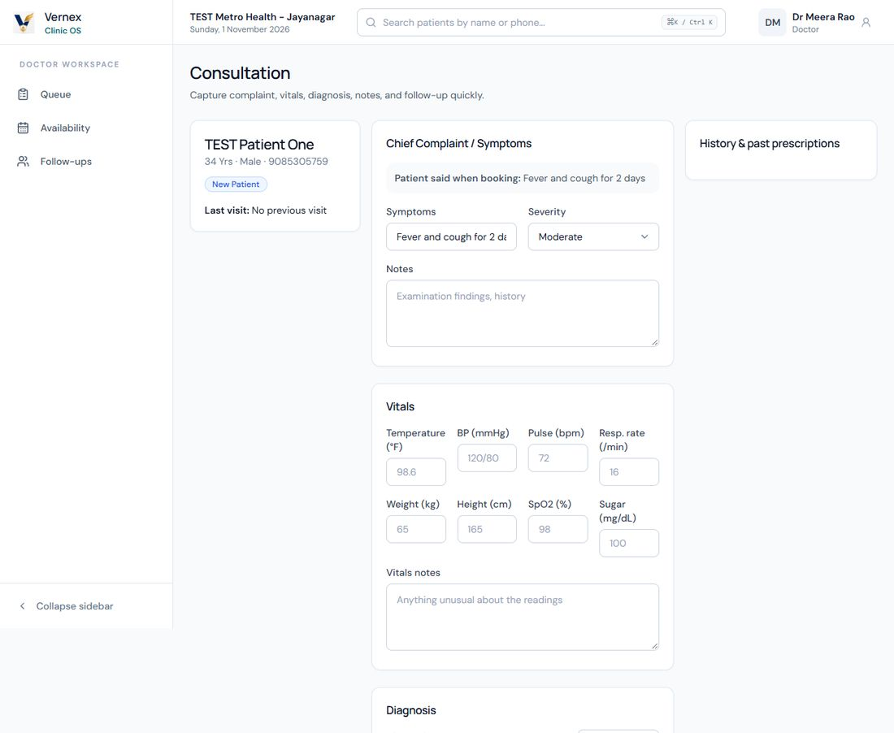

EXPECT: A page **Consultation**. On the left a patient card with name, age and gender, phone, a **New Patient** badge and last visit (no raw ID codes). In the middle four sections:
- **Chief Complaint / Symptoms**: a grey note "Patient said when booking: ...", then Symptoms, Severity (Mild, Moderate, Severe) and Notes.
- **Vitals**: Temperature (°F), BP (mmHg), Pulse (bpm), Resp. rate (/min), Weight (kg), Height (cm), SpO2 (%), Sugar (mg/dL), Vitals notes. Every box has a **visible label**.
- **Diagnosis**: Diagnosis, provisional or final, Advice to patient.
- **Follow-up**: date and reason.
On the right a box "History & past prescriptions". At the bottom: **Save Draft**, **Continue to Prescription**, **Complete Without Prescription**, **Back to queue**.
DO: Type Temperature `101.2`, BP `118/76`, Pulse `92`, Diagnosis `Acute viral fever`, Advice `Rest and fluids`. Click **Save Draft**.
EXPECT: "Consultation draft saved." Back on the queue the patient shows **With doctor**.
DO: Press `F5` and reopen the consultation.
EXPECT: What you typed is still there.
RESULT:

## 6.4 Writing the prescription
DO: Click **Continue to Prescription**.

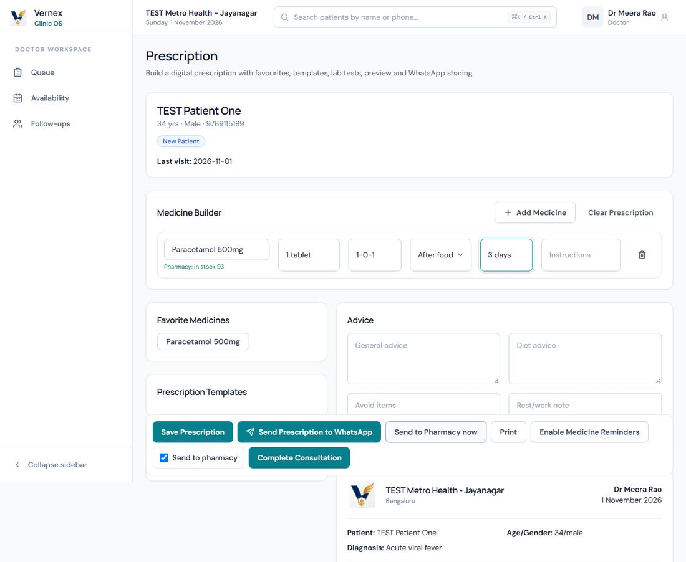

EXPECT: **Prescription** with the patient on top, a **Medicine Builder** (**Add Medicine**, **Clear Prescription**), Favorite Medicines, Prescription Templates, Lab Test Suggestions, advice boxes (General advice, Diet advice, Avoid items, Rest/work note) and a live preview of the prescription with the clinic name, doctor, date, patient and the diagnosis you wrote.
DO: In the first medicine row type Medicine `Paracetamol 500mg`, Dosage `1 tablet`, frequency `1-0-1`, Duration `3 days`, Timing After food.
EXPECT: The preview lists the medicine. If the pharmacy already stocks it, suggestions appear as you type.
DO: Click **Save Prescription**.
EXPECT: "Prescription saved."
DO: Make sure **Send to pharmacy** is ticked and click **Send to Pharmacy now**.
EXPECT: "Prescription sent to pharmacy."
DO: Click **Complete Consultation**.
EXPECT: A message "Consultation completed. Prescription sent to pharmacy." and you are taken **back to the queue**.
DO: Look at the queue.
EXPECT: The patient shows **Completed** and the Completed Today card goes up.
NOTE: In older versions the visit stayed "with doctor" forever. Check this carefully.
DO: Open **Pending Payments** as reception.
EXPECT: A **₹500** consultation bill for this patient was created **automatically** (the doctor's fee).
TRY: Click **Send Prescription to WhatsApp**, **Print**, and **Enable Medicine Reminders**.
EXPECT: Note what each does. Messages are simulated (see Part 9).
RESULT:

## 6.5 Follow-ups and reminders
DO: Click **Follow-ups**.

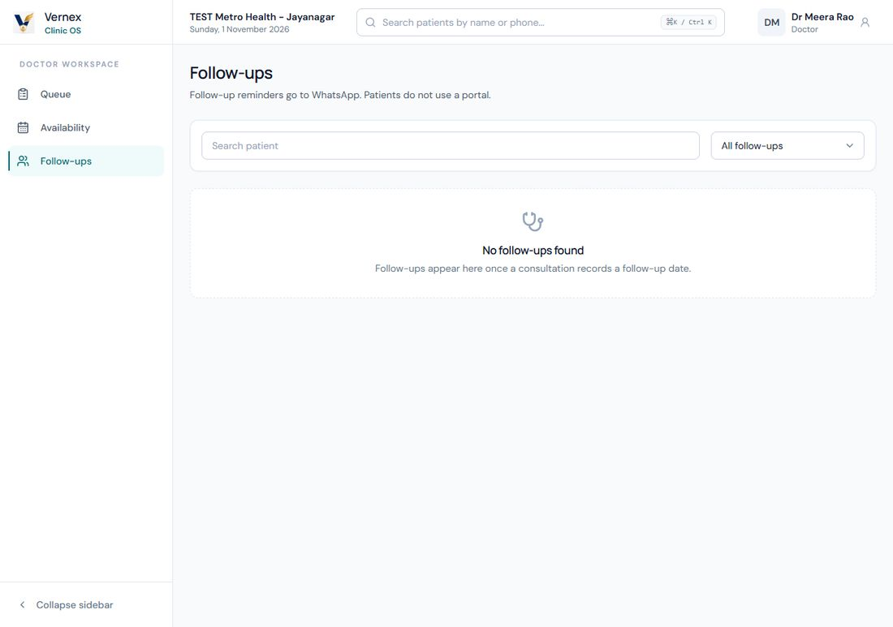

EXPECT: **Follow-ups** with tabs All follow-ups, Today, Upcoming, Overdue, Completed. With no data: "No follow-ups found. Follow-ups appear here once a consultation records a follow-up date."
DO: Record a visit with a follow-up date in 6.3, then return here.
EXPECT: The follow-up appears under Upcoming.
TRY: Open the reminders page by adding `/doctor/patient-reminders` to the address.

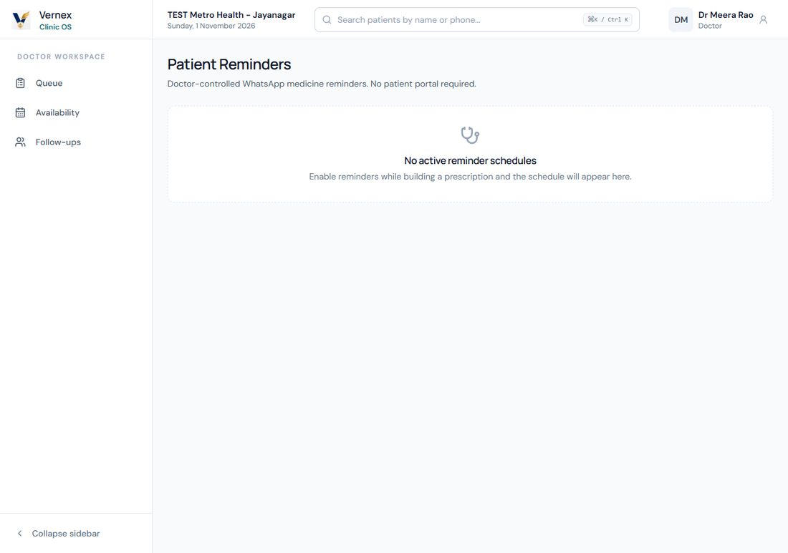

EXPECT: **Patient Reminders**. With none: "No active reminder schedules. Enable reminders while building a prescription and the schedule will appear here."
RESULT:

## 6.6 Patient profile
DO: In the queue click **Profile** on a patient.
EXPECT: The patient's history timeline, allergies and past visits.
TRY: In the top bar search for a patient by name or phone (the shortcut is `Ctrl + K`).
EXPECT: A list of matches; choosing one opens their profile.
RESULT:

---

# Part 7: The pharmacy

Sign in as `pharmacist@testjay.test`. Menu: **Dashboard, Prescription Queue, Counter Billing, Medicine Stock, Add Stock, Low Stock, Expiry Alerts**.

## 7.1 The pharmacy dashboard
EXPECT: A greeting with the person's name, six cards (Pending prescriptions, Dispensed today, Today's sales, Low stock items, Expiring in 30 days, Expired stock value) and shortcut buttons **Add stock**, **Upload Excel**, **New counter sale**, **Open queue**.

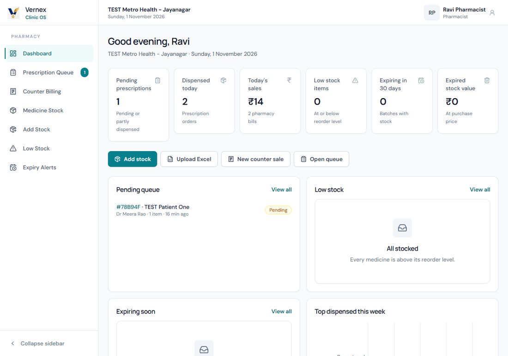
RESULT:

## 7.2 Adding stock first
Medicines can only be handed out if they are in stock.
DO: Click **Add Stock**.

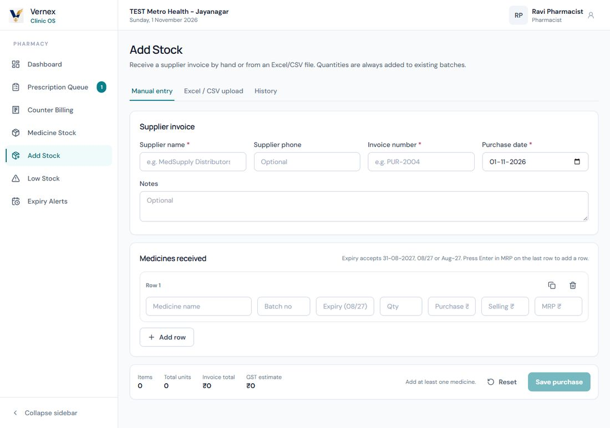

EXPECT: Three tabs **Manual entry**, **Excel / CSV upload**, **History**. A **Supplier invoice** section (Supplier name, Supplier phone, Invoice number, Purchase date, Notes) and a **Medicines received** table, with a running total (Items, Total units, Invoice total, GST estimate).
DO: Supplier name `Test Supplier`, invoice number `PUR-1001`, today's date. In the first row: Medicine `Paracetamol 500mg`, Batch `PCM-B1`, Expiry `31-08-2028`, Quantity `100`, Purchase price `1.2`, Selling price `2`, MRP `2.5`. Click **Save purchase**.
EXPECT: A message like "Saved 1 item (₹120): 1 new batch, 0 topped up, 1 new medicine."
TRY: Save the same medicine and batch again with quantity 20.
EXPECT: The message should say "0 new batches, 1 topped up": the stock increases to 120 and no duplicate batch is created.
DO: Open the **History** tab.
EXPECT: Both purchases are listed.
TRY: Enter an expiry date in the past, or leave Quantity empty.
EXPECT: A clear error, not a saved purchase.
RESULT:

## 7.3 The prescription queue and dispensing
DO: Click **Prescription Queue** (a number badge shows how many are waiting).

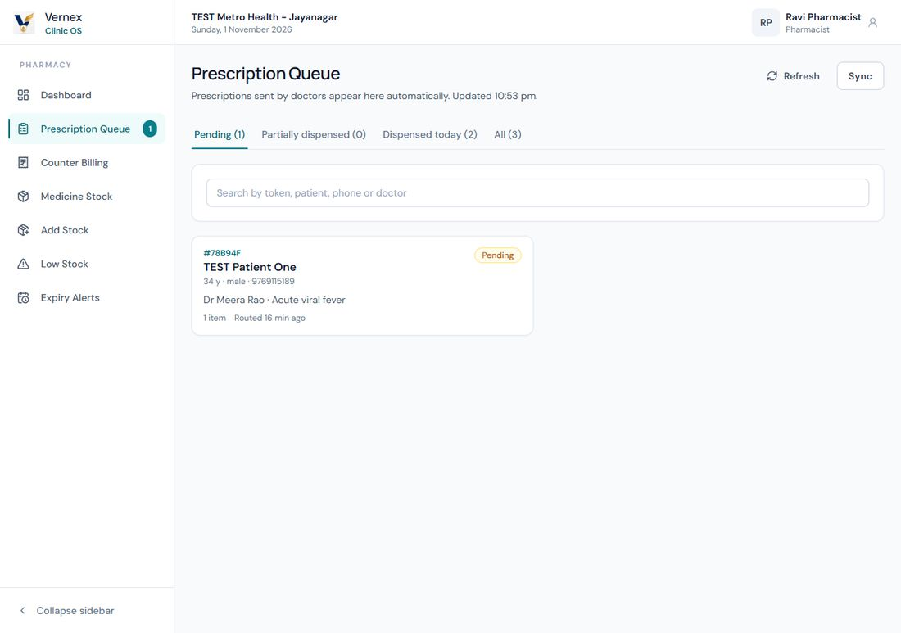

EXPECT: Tabs **Pending, Partially dispensed, Dispensed today, All** with counts. A list of prescriptions, each with a short number such as #78B94F, the patient, a status, the doctor and diagnosis, the number of items and "Routed 2 min ago".
DO: Click a pending prescription.

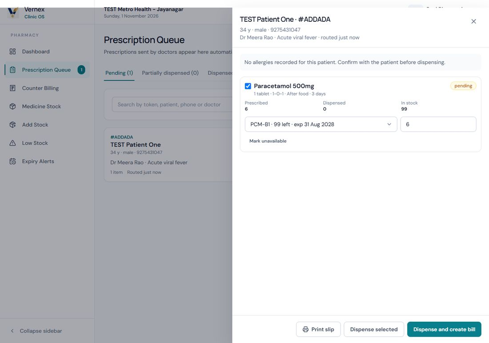

EXPECT: A panel with the patient, a note **"No allergies recorded for this patient. Confirm with the patient before dispensing."**, and for each medicine: the dosage line (1 tablet, 1-0-1, After food, 3 days), **Prescribed 6**, **Dispensed**, and **In stock** with the batch, quantity left and expiry date. Buttons **Mark unavailable**, **Print slip**, **Dispense selected**, **Dispense and create bill**.
NOTE: The amount prescribed must be **6**: the frequency `1-0-1` means two doses a day, and 2 doses times 3 days is 6 tablets. It used to default to 1.
DO: Click **Dispense and create bill**.
EXPECT: A message "Bill INV-... created. Dispensed 1 item for ...", the prescription moves to **Dispensed today**, and a printable pharmacy bill appears with the time in **IST**.
DO: Open **Medicine Stock**.
EXPECT: The stock went down by 6.
TRY: If a prescribed medicine has no stock, the line says "unavailable". Add stock, then click **Sync** at the top of the queue.
EXPECT: The line becomes available and can be dispensed.
TRY: Click **Mark unavailable** on a line.
EXPECT: It is closed as unavailable and the order is settled.
RESULT:

## 7.4 Medicine stock
DO: Click **Medicine Stock**.

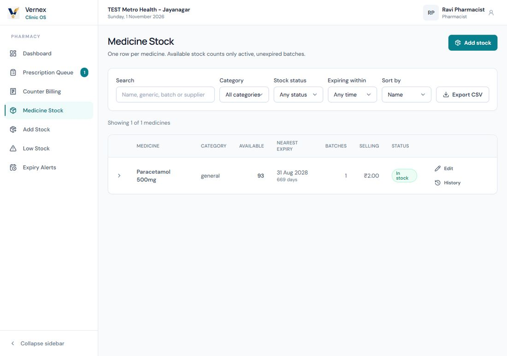

EXPECT: One row per medicine with name, category, available quantity, nearest expiry (with days left), batches, selling price, status (In stock, Low, Out, Expired) and **Edit** and **History** buttons. Filters for category, stock status, expiry window and sorting; **Add stock** and **Export CSV**.
DO: Use the filters and the sort list.
EXPECT: The list changes sensibly.
TRY: Click **History** on a medicine.
EXPECT: Every change (purchase, dispense) is listed with the quantity and when it happened.
TRY: Click **Export CSV**.
EXPECT: A file downloads and opens in a spreadsheet.
RESULT:

## 7.5 Counter billing (selling without a prescription)
DO: Click **Counter Billing**.

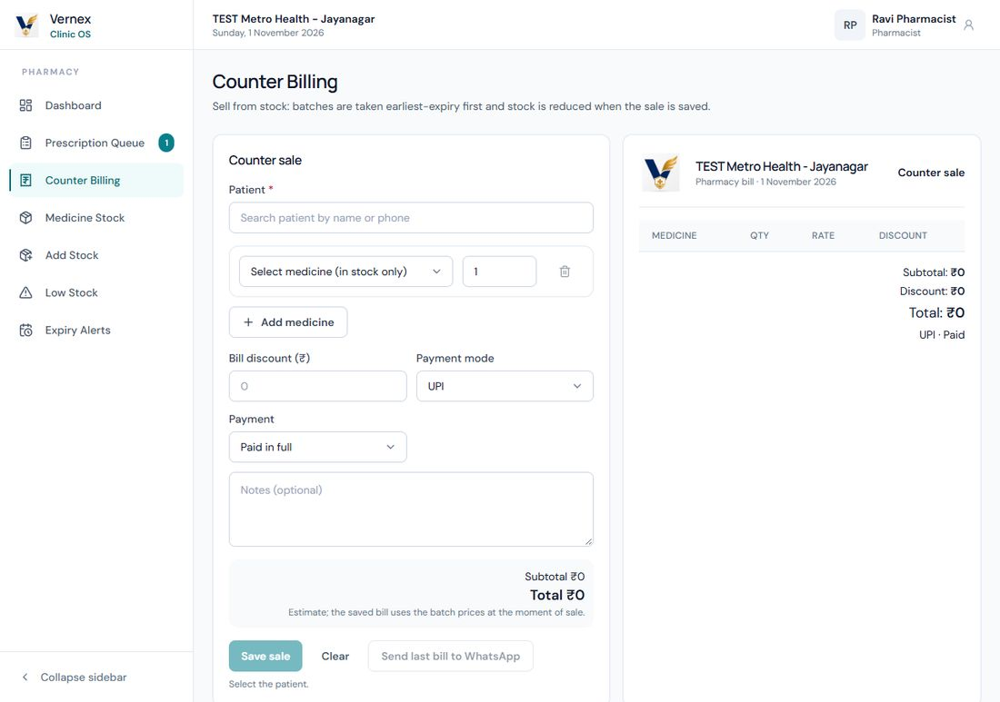

EXPECT: **Counter sale** with a **Patient** box, a medicine list showing **in-stock medicines only** (with how many are left), **Add medicine**, a bill discount, payment mode (Cash, UPI, Card, Online link), payment (Paid in full, Part paid, Not paid yet), totals, and buttons **Save sale**, **Clear**, **Send last bill to WhatsApp**.
DO: Choose a patient, add `Paracetamol 500mg` quantity 2, Paid in full, Cash, **Save sale**.
EXPECT: A bill is created and stock goes down by 2.
TRY: Ask for more than the stock available.
EXPECT: A clear refusal.
RESULT:

## 7.6 Low stock and expiry alerts
DO: Open **Low Stock** and **Expiry Alerts**.

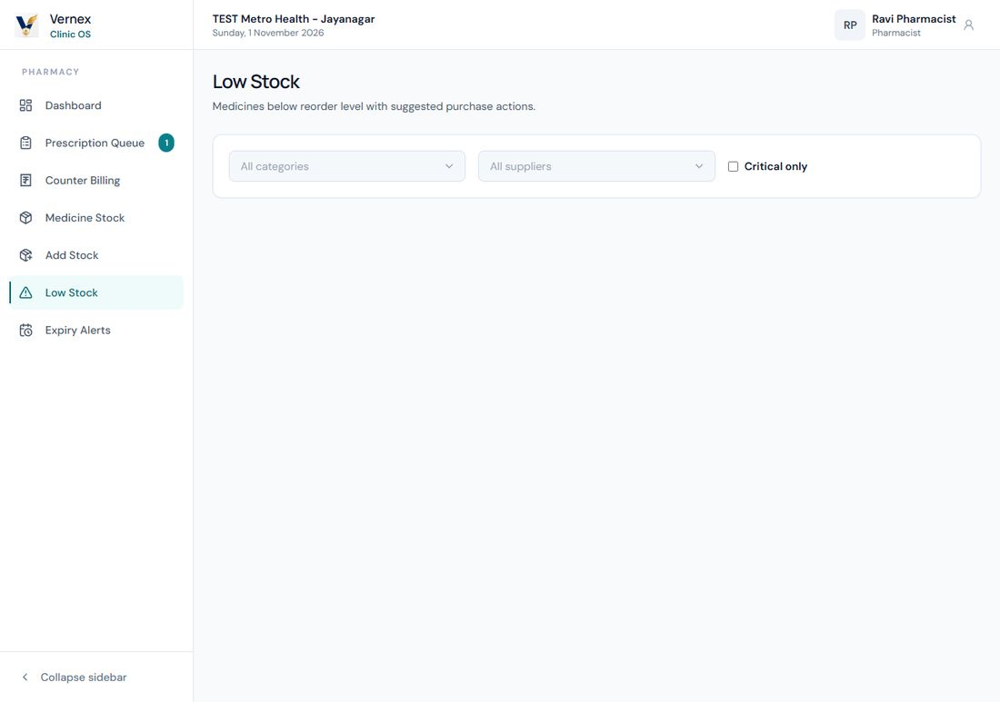

EXPECT: **Low Stock**: medicines at or below their reorder level with filters (category, supplier, Critical only). **Expiry Alerts**: three tabs **Expiring Soon, Expired, Safe Stock**.
TRY: Add a batch that expires in 20 days.
EXPECT: It appears under **Expiring Soon**.
TRY: Sell stock until a medicine drops below its reorder level.
EXPECT: It appears in Low Stock, and on the owner dashboard under "Low stock medicines".
RESULT:

---

# Part 8: Billing and money

Billing pages can be opened by the owner, admin and receptionist (and the pharmacist for pharmacy bills). Use the owner for the first pages.

## 8.1 Billing overview
DO: As the owner open **Billing**.

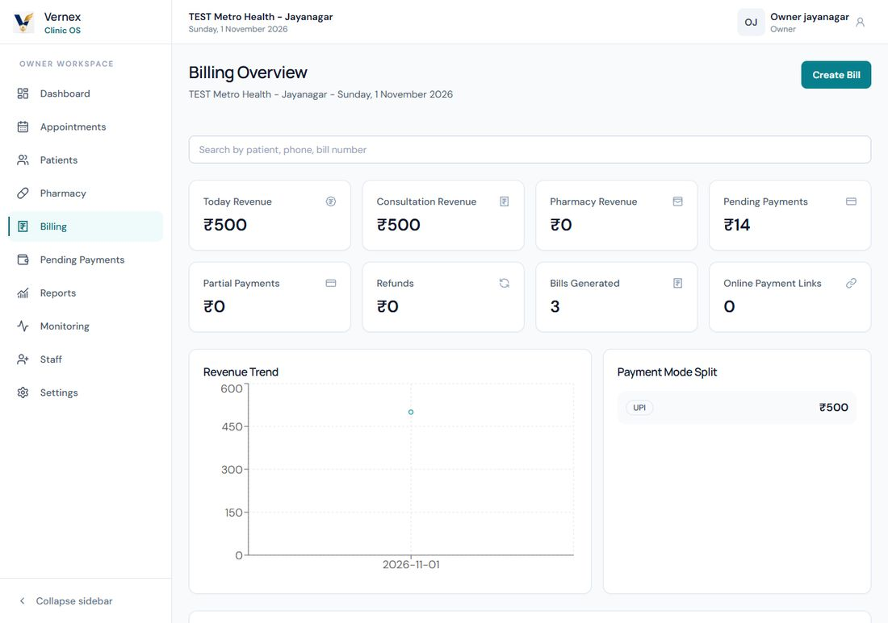

EXPECT: **Billing Overview** with a **Create Bill** button and cards: Today Revenue, Consultation Revenue, Pharmacy Revenue, Pending Payments, Partial Payments, Refunds, Bills Generated, Online Payment Links. Below: a **Revenue Trend** chart, **Payment Mode Split**, and **Recent Invoices**.
NOTE: The cards on this page must agree with the owner dashboard and the Invoices list.
RESULT:

## 8.2 Collecting a payment
DO: As the receptionist open **Pending Payments**.

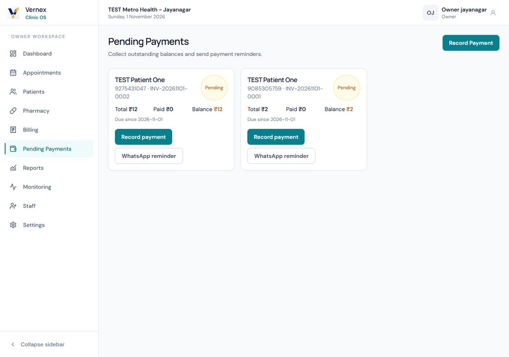

EXPECT: One card per unpaid bill with the patient, phone, invoice number, a **Pending** badge, **Total, Paid, Balance**, "Due since" the date, and the buttons **Record payment** and **WhatsApp reminder**.
DO: On the ₹500 consultation bill click **Record payment**.

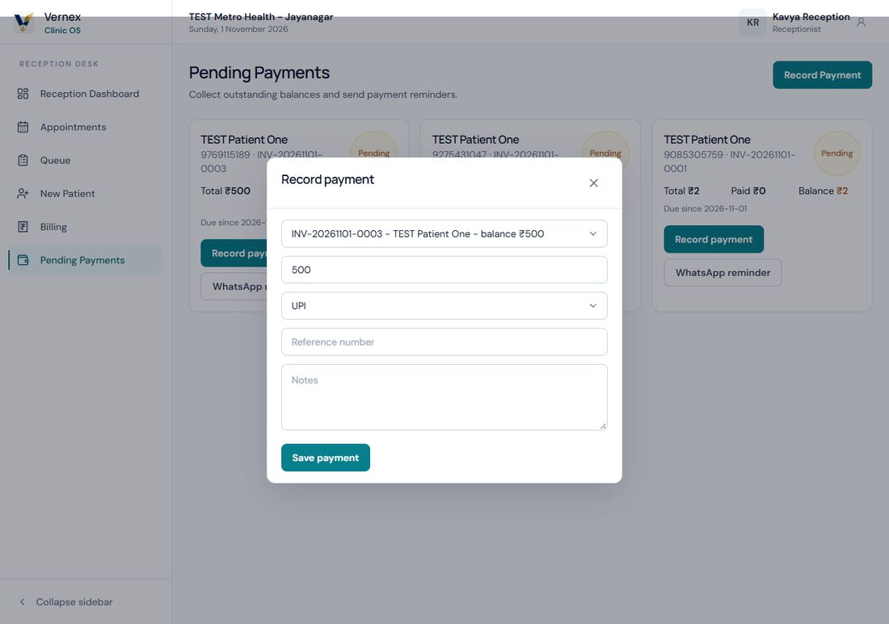

EXPECT: A window **Record payment** with **Select invoice** (the one you clicked is chosen, balances shown), **Amount received** (limited to the balance), **Payment mode** (UPI, Cash, Card, Online Link), **Reference number**, **Notes**, and **Save payment**.
DO: Enter `200`, mode Cash, **Save payment**.
EXPECT: "Payment recorded."
TRY: Look at the bill again.
EXPECT: It should now show **Partial** with Paid 200 and Balance 300.
TRY: Record the remaining `300`.
EXPECT: The bill disappears from Pending Payments and shows **Paid** on the Invoices page.
TRY: Try to enter more than the balance.
EXPECT: Not allowed.
TRY: Click **WhatsApp reminder**.
EXPECT: A message that a reminder was queued. Check Part 9 to see it.
RESULT:

## 8.3 Invoices
DO: Open the **Invoices** page (the **View all** link on the Billing overview).

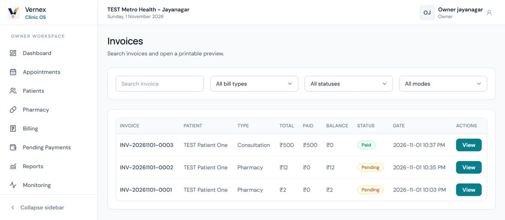

EXPECT: Filters (bill type, status, payment mode) and a table: **Invoice, Patient, Type, Total, Paid, Balance, Status, Date** and a **View** button. On a very wide screen the **Phone** and **Mode** columns also appear. Dates are in IST with AM or PM. On a small laptop the table may scroll sideways **inside its own box**; the page itself must not.
DO: Click **View** on an invoice.
EXPECT: A printable invoice: clinic name and address, invoice number, patient, items, totals.
DO: Use each filter.
EXPECT: The list narrows correctly.
RESULT:

## 8.4 Receipts
DO: Open the Receipts page (type `/billing/receipts` after the address).

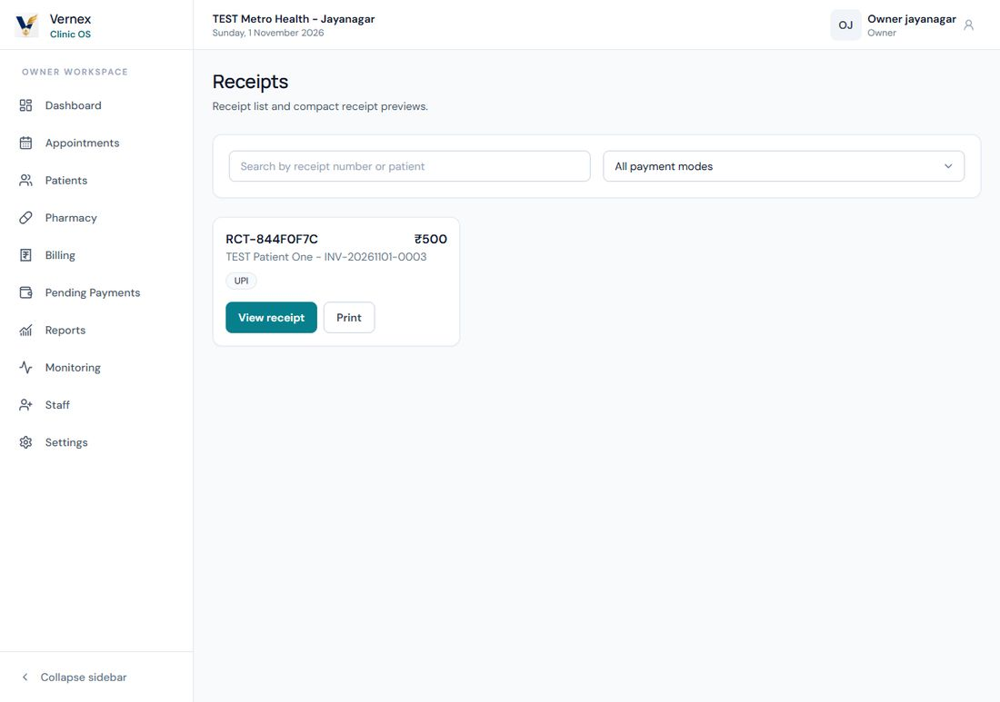

EXPECT: One row for each payment you took, with a receipt number like **RCT-...**, amount, patient, invoice, mode, and **View receipt** and **Print**.
RESULT:

## 8.5 Creating a bill by hand
DO: Click **Create Bill** on the Billing overview.

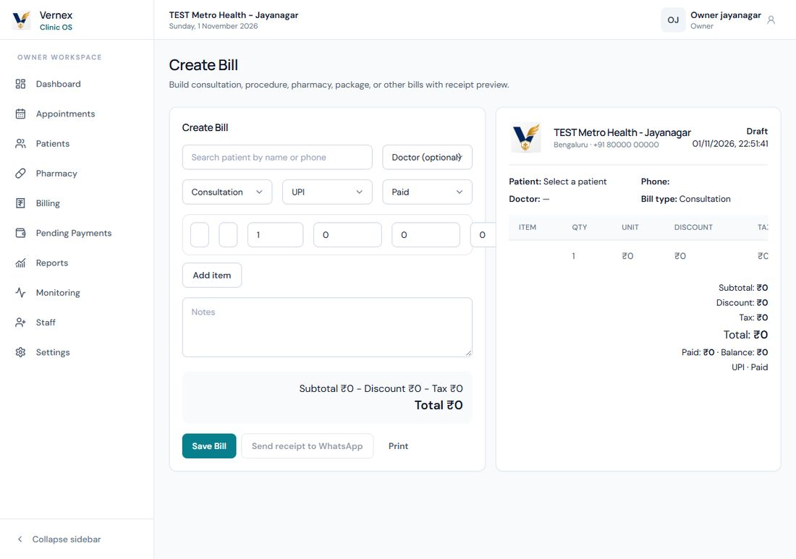

EXPECT: **Create Bill** with a patient box, a doctor (optional), bill type (Consultation, Procedure / Service, Pharmacy, Package, Other), payment mode, status (Paid, Pending, Partial, Draft / cancelled), **Add item**, totals, and buttons **Save Bill**, **Send receipt to WhatsApp**, **Print**, plus a receipt preview.
DO: Choose a patient, add an item `Dressing` at ₹150, quantity 2, a ₹20 discount, set status Pending, **Save Bill**.
EXPECT: Total ₹280 (150 times 2 minus 20). The bill appears on Invoices and Pending Payments.
NOTE: This page must not stretch wider than the screen on any device.
RESULT:

## 8.6 Refunds
DO: Open **Refunds** (type `/billing/refunds` after the address).

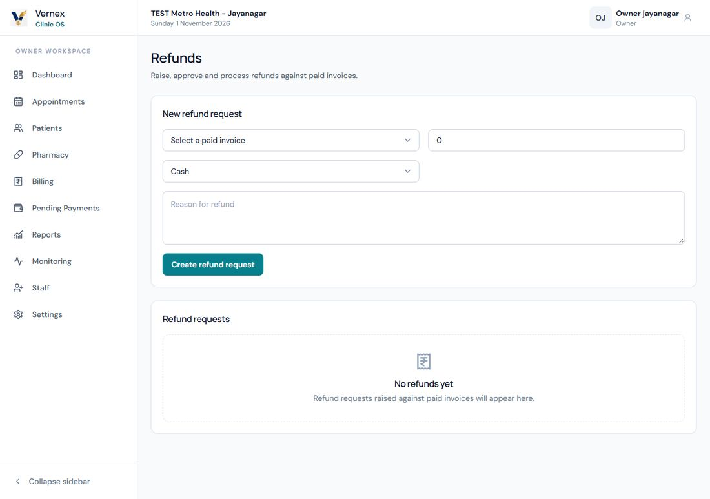

EXPECT: **New refund request** with a paid invoice to choose, an amount, a mode, and **Create refund request**; below, a list of **Refund requests** ("No refunds yet" at first).
TRY: Raise a refund for a paid invoice, then approve and process it.
EXPECT: The refund appears in the list with its status; the **Refunds** card on the Billing overview goes up.
TRY: Try to refund more than was paid.
EXPECT: Not allowed.
RESULT:

## 8.7 Reports
DO: Click **Reports**.

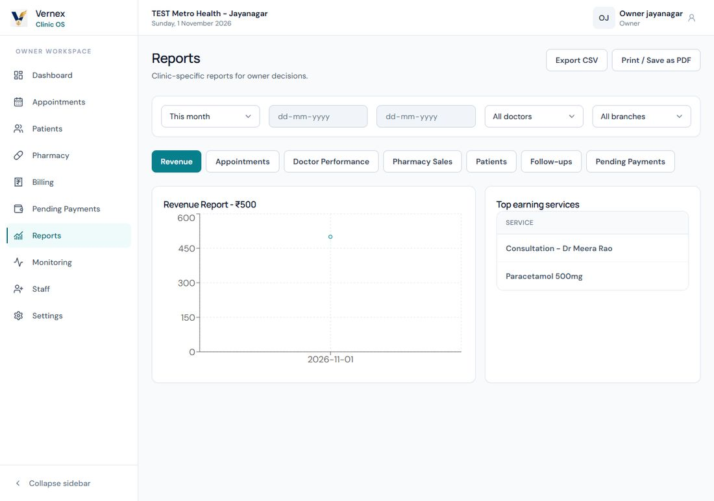

EXPECT: Date shortcuts (**Today, Yesterday, Last 7 days, This month, Custom date range**), filters for doctor and branch, tabs **Revenue, Appointments, Doctor Performance, Pharmacy Sales, Patients, Follow-ups, Pending Payments**, and buttons **Export CSV** and **Print / Save as PDF**.
DO: Click each tab.
EXPECT: Each shows its own table or chart without errors; Revenue for today matches the billing overview.
DO: Click **Export CSV**.
EXPECT: A file downloads.
DO: Pick a date range with no activity.
EXPECT: A clear "nothing in this period" message instead of broken charts.
RESULT:

---

# Part 9: WhatsApp (simulated for now)

IMPORTANT: Nothing is sent to real phones yet. Messages are **simulated**. They are marked as delivered inside the system so you can test every screen. Real sending is switched on later (see the Integration Guide).

Sign in as the owner. The menu does not list WhatsApp, so type the page addresses after the website address.

## 9.1 WhatsApp dashboard
DO: Open `/whatsapp-booking/dashboard`.


EXPECT: **WhatsApp Booking** with an orange banner **WhatsApp not connected**, the clinic's WhatsApp number, six cards (Booking Requests, Appointments Booked, Pending Conversations, Reminders Scheduled, Failed Messages, Templates Active) and a "How it works" list.
RESULT:

## 9.2 The booking console (a pretend chat)
DO: Click **Open booking console** (`/whatsapp-booking/simulator`).


EXPECT: **WhatsApp Booking Console** showing a chat. It offers departments, then doctors (with fee and the next free slot), then dates and slots, then asks for the patient's name and age.
DO: Follow the chat: choose a department, a doctor, a date, a slot, give a name and age, then click **Confirm booking**.
EXPECT: A message such as "Your appointment is booked. Your slot is reserved." with a token. The same appointment then shows up with source **WhatsApp** on the reception appointments list. The wording must never say a doctor "confirmed" it.
DO: Use **Restart** and **Copy conversation**.
EXPECT: Restart begins again; Copy conversation puts the text on your clipboard.
RESULT:

## 9.3 Templates, conversations and settings
DO: Open `/whatsapp-booking/templates`, `/whatsapp-booking/conversations` and `/whatsapp-booking/settings`.


EXPECT:
- **Templates**: a **New Template** button, a status filter (Active, Draft, Needs API approval, Disabled) and "No templates found" when empty.
- **Conversations**: filters by status and source, **Create Conversation**, and "No conversations found" when empty.
- **Settings**: the clinic's WhatsApp number, switches such as **Enable WhatsApp booking**, **Allow existing patient lookup**, **Require payment before confirmation**, **Send reminder before appointment**, and **Save settings** / **Discard changes**.
TRY: Create a template, a conversation, and change a setting, then Save and refresh.
EXPECT: Everything you saved is still there.
TRY: After clicking **WhatsApp reminder** on Pending Payments, or **Send Prescription to WhatsApp**, open Conversations or the WhatsApp dashboard.
EXPECT: A message is recorded as delivered (simulated). If the patient has opted out of WhatsApp, the message must be refused instead.
RESULT:

---

# Part 10: One whole day, start to finish

This puts everything together. Use two or three windows. Tick each line as you go.

| Step | Who | What to do | You should see |
|---|---|---|---|
| 1 | Doctor | Check Availability has working hours for today (or use tomorrow). | Schedule saved. |
| 2 | Pharmacist | Add stock: Paracetamol 500mg, 100 units (7.2). | "Saved 1 item". |
| 3 | Patient (no sign-in) | Book a visit (1.4). Write down the token. | Appointment Booked, token A00x. |
| 4 | Patient | Look it up in My appointments (1.7). | Card with a masked name. |
| 5 | Reception | Find it on the dashboard. Click **Check in**. | "Patient checked in." |
| 6 | Doctor | Press Refresh. Click **Start Consultation**. Add vitals and a diagnosis. **Save Draft**. | Status **With doctor**. |
| 7 | Doctor | **Continue to Prescription**: Paracetamol 500mg, 1 tablet, 1-0-1, 3 days. Save, **Send to Pharmacy now**, **Complete Consultation**. | Back on the queue, patient **Completed**. |
| 8 | Pharmacist | Open the Prescription Queue, open it, check **Prescribed 6**, **Dispense and create bill**. | Bill created, stock down by 6. |
| 9 | Reception | Open **Pending Payments**. | Two bills: ₹500 consultation and ₹12 pharmacy. |
| 10 | Reception | Record both payments in full. | "Payment recorded." Pending list is empty. |
| 11 | Owner | Open the dashboard and Billing overview. | Revenue went up by the amount collected, and Pending Payments dropped. |
| 12 | Owner | Open Reports for Today. | Revenue and Appointments reports include this visit. |
| 13 | Patient | Open My appointments again. | The visit shows as **Completed**. |

NOTE: At every step check the **times** are in 12-hour format and in Indian time, and that nothing on a screen says "undefined", "NaN" or shows a long ID code.

---

# Part 11: Privacy and "should not be able to" checks

A good system also refuses things. These checks matter as much as the ones that work.

## 11.1 Pages each role must **not** open
DO: Signed in as each role, type these addresses after the website address.

| Role | Must show "Access denied" for |
|---|---|
| Doctor | `/owner/dashboard`, `/reception/dashboard`, `/pharmacy/stock`, `/billing/dashboard`, `/super-admin/dashboard` |
| Receptionist | `/doctor/queue`, `/owner/settings`, `/owner/staff`, `/super-admin/dashboard` |
| Pharmacist | `/owner/staff`, `/doctor/queue`, `/reception/dashboard` |
| Owner or admin | `/super-admin/dashboard`, `/doctor/queue` |
| Anyone not signed in | Any of the above should send you to the sign-in page |

EXPECT: **Access denied** (or the sign-in page), never the real page.
RESULT:

## 11.2 One clinic must never see another's data
DO: Sign in as `owner@testsolo.test` (a different business). Open **Patients**, **Appointments**, **Billing**, and **Reports**.
EXPECT: Nothing from the Jayanagar clinic appears: no TEST Patient One, no Dr Meera Rao, no invoices from Jayanagar.
DO: Sign in as `owner.whitefield@testmetro.test` (same brand, different clinic).
EXPECT: Also none of Jayanagar's patients or bills. Sharing a brand does **not** share patient data.
DO: As the shared admin, switch between clinics (4.4).
EXPECT: Each clinic shows only its own data, and only one clinic is "active" at a time.
RESULT:

## 11.3 Role limits inside a clinic
DO: As the receptionist, look for any way to read a doctor's clinical notes or diagnosis.
EXPECT: Receptionists can see appointments and patients but **not** clinical notes. The reception pages show no diagnosis or vitals.
TRY: As the pharmacist, try to find the appointment book.
EXPECT: There is no Appointments menu for the pharmacist; they work from prescriptions routed to them.
DO: As the owner, try to add a staff member.
EXPECT: Not possible; only an admin can.
RESULT:

## 11.4 The patient lookup keeps secrets
DO: Look up a number in **My appointments** (1.7).
EXPECT: Names are partly hidden (Asha V.) and there is **no** diagnosis, medicine, vitals or bill anywhere.
NOTE: Anyone who knows a patient's phone number can still see that a booking exists at that clinic. This is a known limit, which a text-message code (OTP) will fix later.
RESULT:

---

# Part 12: A full pass on a phone-sized screen

Switch to the phone layout (width 375). Check these pages. On every one: nothing cut off, **no sideways scrolling**, tables turn into cards or can be scrolled inside their own box, buttons are easy to tap.

| Page | Signed in as | Look for |
|---|---|---|
| Clinic page and booking flow (all 5 steps) | Nobody | Doctor cards stack; date chips scroll sideways inside their own row. |
| Success page and My appointments | Nobody | Buttons are full width and readable. |
| Sign-in page | Nobody | The form is readable and not squeezed. |
| Reception dashboard | Reception | Cards in two columns; Check in button reachable. |
| Appointments | Reception | Cards instead of a wide table. |
| Doctor queue | Doctor | Cards fit; Start Consultation easy to tap. |
| Consultation | Doctor | Fields stack in one column with their labels. |
| Prescription | Doctor | Medicine rows readable. |
| Pharmacy queue and dispensing | Pharmacist | The detail opens and the buttons are visible. |
| Billing overview, Invoices, Create Bill | Owner | Charts do not push the page wider. |
| Pending Payments and Record payment | Receptionist | The pop-up fits the screen. |
| Platform overview | Platform admin | The long Staff table scrolls inside its box. |

RESULT:

---

# Part 13: Setting up a brand-new clinic from nothing

This is the real "first day" for a new customer. It uses the clinics and logins you created in Part 3 (**Walkthrough Health - Central** and **East**).

| Step | Who | What to do | You should see |
|---|---|---|---|
| 1 | Admin `admin@walkthrough.test` | Sign in. | Lands on Clinic overview. A **clinic switcher** shows Central and East. |
| 2 | Admin | Staff, **Add staff**: a doctor (fee 400), a receptionist, a pharmacist. | Each appears in the directory. |
| 3 | Admin | Switch to East and add a receptionist there. | Appears in East's staff list only. |
| 4 | Doctor (new) | Sign in, open Availability, enable Monday to Friday 9 to 5 and save each day. | "availability saved" for each day. |
| 5 | Owner `owner.central@walkthrough.test` | Settings: add a service and tick Bookable. | The service shows on the public booking page. |
| 6 | Patient | Open `/book` and find **Walkthrough Health - Central**. Book with the new doctor. | Booked, token A001. |
| 7 | New receptionist | Check the patient in. | Checked in. |
| 8 | New doctor, pharmacist | Complete the visit as in Part 10. | Bills appear at the fee you set (₹400). |
| 9 | Owner | Dashboard and Billing. | Numbers match, and only Central's data. |
| 10 | Owner of East | Sign in. | **None** of Central's patients or bills. |
RESULT:

---

# Appendix A: Things that are **not** expected to work yet

Do not report these as problems. They are known and planned.

| Area | What you will see | Why |
|---|---|---|
| Online payment | "Pay online placeholder: Online payment is not available yet" in booking; "Online Link" mode exists for recording only. | The payment gateway (Razorpay) is not connected. |
| WhatsApp | "WhatsApp not connected"; messages only simulated. | A real WhatsApp Business account is needed. |
| WhatsApp replies | Patients cannot reply and have messages show "read". | The receiving part is not built yet. |
| SMS | No text messages anywhere. | Not built yet. |
| Patient codes (OTP) | My appointments needs only a phone number. | Needs SMS first. |
| Email | No emails are sent (receipts, reminders). | Not built yet. |
| Subscriptions | Plans are stored but nothing is charged. | Billing for the platform itself is not built. |

# Appendix B: If something goes wrong

| Problem | Try this |
|---|---|
| A page is blank or keeps loading | Press `F5`. If it stays blank, press `Ctrl + Shift + R`. Note the page and what you clicked before. |
| "Invalid login credentials" | Check the email (no spaces) and the password. Ask the product owner for the test password. |
| No slots are offered for today | Working hours for today are over. Choose tomorrow. |
| The doctor does not appear for booking | They need a schedule: sign in as the doctor and set Availability. |
| You see the wrong clinic's data | You are in a different clinic. Check the top bar; use the clinic switcher. |
| The address does not open | The app may not be running. Ask the developer to run `npm run dev`. |
| You see a technical message with codes | That is a bug. Take a screenshot and report it. |

# Appendix C: Master checklist

Tick each page when you have finished it.

| Page | Part | Done |
|---|---|---|
| Home, clinic list, clinic page | 1.1 to 1.3 | [   ] |
| Booking flow, success page | 1.4, 1.5 | [   ] |
| Same-slot test | 1.6 | [   ] |
| My appointments | 1.7 | [   ] |
| Phone layout of public pages | 1.8 | [   ] |
| Sign-in, access denied, sign-out | Part 2 | [   ] |
| Platform overview, create clinic, logins, sharing | 3.1 to 3.7 | [   ] |
| Subscriptions, Usage, Support, Settings, Monitoring | 3.8 | [   ] |
| Owner dashboard, Staff, Settings | 4.1, 4.2, 4.5 | [   ] |
| Adding staff, clinic switcher | 4.3, 4.4 | [   ] |
| Reception dashboard and check-in | 5.1, 5.2 | [   ] |
| Appointments, add, reschedule, cancel | 5.3 to 5.5 | [   ] |
| Queue, new patient, billing shortcut | 5.6 to 5.8 | [   ] |
| Doctor queue, availability, block date | 6.1, 6.2 | [   ] |
| Consultation, prescription | 6.3, 6.4 | [   ] |
| Follow-ups, reminders, patient profile | 6.5, 6.6 | [   ] |
| Pharmacy dashboard, add stock | 7.1, 7.2 | [   ] |
| Prescription queue and dispensing | 7.3 | [   ] |
| Stock, counter billing, low stock, expiry | 7.4 to 7.6 | [   ] |
| Billing overview, payments, invoices, receipts | 8.1 to 8.4 | [   ] |
| Create bill, refunds, reports | 8.5 to 8.7 | [   ] |
| WhatsApp pages | Part 9 | [   ] |
| Whole-day story | Part 10 | [   ] |
| Privacy and permission checks | Part 11 | [   ] |
| Phone-size pass | Part 12 | [   ] |
| New clinic from nothing | Part 13 | [   ] |

# Appendix D: Problem log

Copy this table into a spreadsheet and fill one row per problem.

| Where (page or address) | What I did | What I expected | What happened |
|---|---|---|---|
| | | | |
| | | | |
| | | | |
